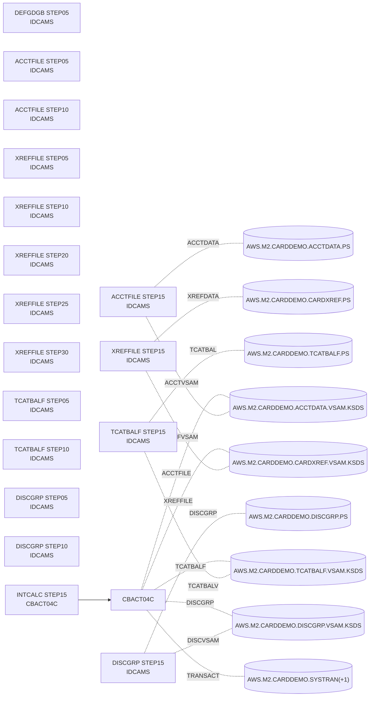
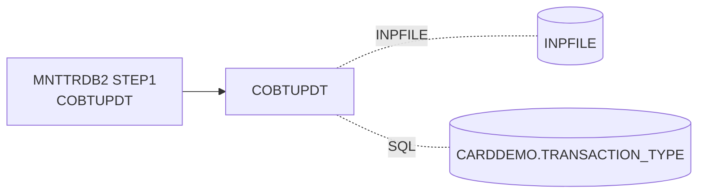
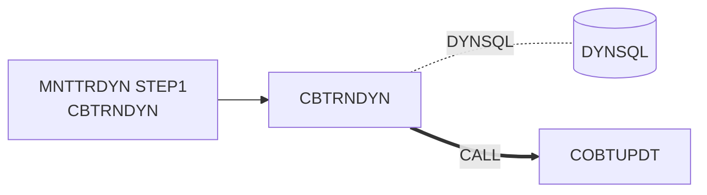

# Chain graph (generated - do not edit)

Generated by `make chain-graph` from the JCL, procs and source under `app/`.
`make chain-graph-check` fails CI when this file is stale.

## Runnable chains

### `posting` - Daily transaction posting: POSTTRAN (CBTRN02C) then TRANREPT (REPRO, SORT, CBTRN03C)

```mermaid
flowchart LR
    DEFGDGB_STEP05["DEFGDGB STEP05<br/>IDCAMS"]
    DALYREJS_STEP05["DALYREJS STEP05<br/>IDCAMS"]
    ACCTFILE_STEP05["ACCTFILE STEP05<br/>IDCAMS"]
    ACCTFILE_STEP10["ACCTFILE STEP10<br/>IDCAMS"]
    ACCTFILE_STEP15["ACCTFILE STEP15<br/>IDCAMS"]
    ACCTFILE_STEP15 -.ACCTDATA.- ds_AWS_M2_CARDDEMO_ACCTDATA_PS[("AWS.M2.CARDDEMO.ACCTDATA.PS")]
    ACCTFILE_STEP15 -.ACCTVSAM.- ds_AWS_M2_CARDDEMO_ACCTDATA_VSAM_KSDS[("AWS.M2.CARDDEMO.ACCTDATA.VSAM.KSDS")]
    XREFFILE_STEP05["XREFFILE STEP05<br/>IDCAMS"]
    XREFFILE_STEP10["XREFFILE STEP10<br/>IDCAMS"]
    XREFFILE_STEP15["XREFFILE STEP15<br/>IDCAMS"]
    XREFFILE_STEP15 -.XREFDATA.- ds_AWS_M2_CARDDEMO_CARDXREF_PS[("AWS.M2.CARDDEMO.CARDXREF.PS")]
    XREFFILE_STEP15 -.XREFVSAM.- ds_AWS_M2_CARDDEMO_CARDXREF_VSAM_KSDS[("AWS.M2.CARDDEMO.CARDXREF.VSAM.KSDS")]
    XREFFILE_STEP20["XREFFILE STEP20<br/>IDCAMS"]
    XREFFILE_STEP25["XREFFILE STEP25<br/>IDCAMS"]
    XREFFILE_STEP30["XREFFILE STEP30<br/>IDCAMS"]
    TCATBALF_STEP05["TCATBALF STEP05<br/>IDCAMS"]
    TCATBALF_STEP10["TCATBALF STEP10<br/>IDCAMS"]
    TCATBALF_STEP15["TCATBALF STEP15<br/>IDCAMS"]
    TCATBALF_STEP15 -.TCATBAL.- ds_AWS_M2_CARDDEMO_TCATBALF_PS[("AWS.M2.CARDDEMO.TCATBALF.PS")]
    TCATBALF_STEP15 -.TCATBALV.- ds_AWS_M2_CARDDEMO_TCATBALF_VSAM_KSDS[("AWS.M2.CARDDEMO.TCATBALF.VSAM.KSDS")]
    DISCGRP_STEP05["DISCGRP STEP05<br/>IDCAMS"]
    DISCGRP_STEP10["DISCGRP STEP10<br/>IDCAMS"]
    DISCGRP_STEP15["DISCGRP STEP15<br/>IDCAMS"]
    DISCGRP_STEP15 -.DISCGRP.- ds_AWS_M2_CARDDEMO_DISCGRP_PS[("AWS.M2.CARDDEMO.DISCGRP.PS")]
    DISCGRP_STEP15 -.DISCVSAM.- ds_AWS_M2_CARDDEMO_DISCGRP_VSAM_KSDS[("AWS.M2.CARDDEMO.DISCGRP.VSAM.KSDS")]
    TRANTYPE_STEP05["TRANTYPE STEP05<br/>IDCAMS"]
    TRANTYPE_STEP10["TRANTYPE STEP10<br/>IDCAMS"]
    TRANTYPE_STEP15["TRANTYPE STEP15<br/>IDCAMS"]
    TRANTYPE_STEP15 -.TRANTYPE.- ds_AWS_M2_CARDDEMO_TRANTYPE_PS[("AWS.M2.CARDDEMO.TRANTYPE.PS")]
    TRANTYPE_STEP15 -.TTYPVSAM.- ds_AWS_M2_CARDDEMO_TRANTYPE_VSAM_KSDS[("AWS.M2.CARDDEMO.TRANTYPE.VSAM.KSDS")]
    TRANCATG_STEP05["TRANCATG STEP05<br/>IDCAMS"]
    TRANCATG_STEP10["TRANCATG STEP10<br/>IDCAMS"]
    TRANCATG_STEP15["TRANCATG STEP15<br/>IDCAMS"]
    TRANCATG_STEP15 -.TRANCATG.- ds_AWS_M2_CARDDEMO_TRANCATG_PS[("AWS.M2.CARDDEMO.TRANCATG.PS")]
    TRANCATG_STEP15 -.TCATVSAM.- ds_AWS_M2_CARDDEMO_TRANCATG_VSAM_KSDS[("AWS.M2.CARDDEMO.TRANCATG.VSAM.KSDS")]
    TRANFILE_CLCIFIL["TRANFILE CLCIFIL<br/>SDSF"]
    TRANFILE_STEP05["TRANFILE STEP05<br/>IDCAMS"]
    TRANFILE_STEP10["TRANFILE STEP10<br/>IDCAMS"]
    TRANFILE_STEP15["TRANFILE STEP15<br/>IDCAMS"]
    TRANFILE_STEP15 -.TRANSACT.- ds_AWS_M2_CARDDEMO_DALYTRAN_PS_INIT[("AWS.M2.CARDDEMO.DALYTRAN.PS.INIT")]
    TRANFILE_STEP15 -.TRANVSAM.- ds_AWS_M2_CARDDEMO_TRANSACT_VSAM_KSDS[("AWS.M2.CARDDEMO.TRANSACT.VSAM.KSDS")]
    TRANFILE_STEP20["TRANFILE STEP20<br/>IDCAMS"]
    TRANFILE_STEP25["TRANFILE STEP25<br/>IDCAMS"]
    TRANFILE_STEP30["TRANFILE STEP30<br/>IDCAMS"]
    TRANFILE_OPCIFIL["TRANFILE OPCIFIL<br/>SDSF"]
    POSTTRAN_STEP15["POSTTRAN STEP15<br/>CBTRN02C"]
    POSTTRAN_STEP15 --> CBTRN02C[CBTRN02C]
    CBTRN02C -.TRANFILE.- ds_AWS_M2_CARDDEMO_TRANSACT_VSAM_KSDS[("AWS.M2.CARDDEMO.TRANSACT.VSAM.KSDS")]
    CBTRN02C -.DALYTRAN.- ds_AWS_M2_CARDDEMO_DALYTRAN_PS[("AWS.M2.CARDDEMO.DALYTRAN.PS")]
    CBTRN02C -.XREFFILE.- ds_AWS_M2_CARDDEMO_CARDXREF_VSAM_KSDS[("AWS.M2.CARDDEMO.CARDXREF.VSAM.KSDS")]
    CBTRN02C -.DALYREJS.- ds_AWS_M2_CARDDEMO_DALYREJS__1_[("AWS.M2.CARDDEMO.DALYREJS(+1)")]
    CBTRN02C -.ACCTFILE.- ds_AWS_M2_CARDDEMO_ACCTDATA_VSAM_KSDS[("AWS.M2.CARDDEMO.ACCTDATA.VSAM.KSDS")]
    CBTRN02C -.TCATBALF.- ds_AWS_M2_CARDDEMO_TCATBALF_VSAM_KSDS[("AWS.M2.CARDDEMO.TCATBALF.VSAM.KSDS")]
    TRANREPT_STEP05R_PRC001["TRANREPT STEP05R.PRC001<br/>IDCAMS"]
    TRANREPT_STEP05R_PRC001 -.FILEIN.- ds_NULLFILE[("NULLFILE")]
    TRANREPT_STEP05R_PRC001 -.FILEOUT.- ds_NULLFILE[("NULLFILE")]
    TRANREPT_STEP05R_PRC001 -.SYSIN.- ds__CNTLLIB_REPROCT_[("&CNTLLIB(REPROCT)")]
    TRANREPT_STEP05R_PRC001 -.PRC001.FILEIN.- ds_AWS_M2_CARDDEMO_TRANSACT_VSAM_KSDS[("AWS.M2.CARDDEMO.TRANSACT.VSAM.KSDS")]
    TRANREPT_STEP05R_PRC001 -.PRC001.FILEOUT.- ds_AWS_M2_CARDDEMO_TRANSACT_BKUP__1_[("AWS.M2.CARDDEMO.TRANSACT.BKUP(+1)")]
    TRANREPT_STEP05R["TRANREPT STEP05R<br/>SORT"]
    TRANREPT_STEP05R -.SORTIN.- ds_AWS_M2_CARDDEMO_TRANSACT_BKUP__1_[("AWS.M2.CARDDEMO.TRANSACT.BKUP(+1)")]
    TRANREPT_STEP05R -.SORTOUT.- ds_AWS_M2_CARDDEMO_TRANSACT_DALY__1_[("AWS.M2.CARDDEMO.TRANSACT.DALY(+1)")]
    TRANREPT_STEP10R["TRANREPT STEP10R<br/>CBTRN03C"]
    TRANREPT_STEP10R --> CBTRN03C[CBTRN03C]
    CBTRN03C -.TRANFILE.- ds_AWS_M2_CARDDEMO_TRANSACT_DALY__1_[("AWS.M2.CARDDEMO.TRANSACT.DALY(+1)")]
    CBTRN03C -.CARDXREF.- ds_AWS_M2_CARDDEMO_CARDXREF_VSAM_KSDS[("AWS.M2.CARDDEMO.CARDXREF.VSAM.KSDS")]
    CBTRN03C -.TRANTYPE.- ds_AWS_M2_CARDDEMO_TRANTYPE_VSAM_KSDS[("AWS.M2.CARDDEMO.TRANTYPE.VSAM.KSDS")]
    CBTRN03C -.TRANCATG.- ds_AWS_M2_CARDDEMO_TRANCATG_VSAM_KSDS[("AWS.M2.CARDDEMO.TRANCATG.VSAM.KSDS")]
    CBTRN03C -.DATEPARM.- ds_AWS_M2_CARDDEMO_DATEPARM[("AWS.M2.CARDDEMO.DATEPARM")]
    CBTRN03C -.TRANREPT.- ds_AWS_M2_CARDDEMO_TRANREPT__1_[("AWS.M2.CARDDEMO.TRANREPT(+1)")]
```

### `interest` - Monthly interest calculation: INTCALC (CBACT04C)



### `trantype-update` - Db2 transaction-type maintenance: MNTTRDB2 (IKJEFT01 -> COBTUPDT) against PostgreSQL



### `trantype-dynamic` - Db2 ad-hoc maintenance: MNTTRDYN (IKJEFT01 -> CBTRNDYN: dynamic SQL PREPARE/EXECUTE, then dynamic CALL of COBTUPDT) against PostgreSQL



## Jobs

| Job | Step | Program | PARM | DD -> dataset |
|---|---|---|---|---|
| [ACCTFILE](app/jcl/ACCTFILE.jcl) | STEP05 | IDCAMS | - | - |
| [ACCTFILE](app/jcl/ACCTFILE.jcl) | STEP10 | IDCAMS | - | - |
| [ACCTFILE](app/jcl/ACCTFILE.jcl) | STEP15 | IDCAMS | - | `ACCTDATA` AWS.M2.CARDDEMO.ACCTDATA.PS<br>`ACCTVSAM` AWS.M2.CARDDEMO.ACCTDATA.VSAM.KSDS |
| [CARDFILE](app/jcl/CARDFILE.jcl) | CLCIFIL | SDSF | - | - |
| [CARDFILE](app/jcl/CARDFILE.jcl) | STEP05 | IDCAMS | - | - |
| [CARDFILE](app/jcl/CARDFILE.jcl) | STEP10 | IDCAMS | - | - |
| [CARDFILE](app/jcl/CARDFILE.jcl) | STEP15 | IDCAMS | - | `CARDDATA` AWS.M2.CARDDEMO.CARDDATA.PS<br>`CARDVSAM` AWS.M2.CARDDEMO.CARDDATA.VSAM.KSDS |
| [CARDFILE](app/jcl/CARDFILE.jcl) | STEP40 | IDCAMS | - | - |
| [CARDFILE](app/jcl/CARDFILE.jcl) | STEP50 | IDCAMS | - | - |
| [CARDFILE](app/jcl/CARDFILE.jcl) | STEP60 | IDCAMS | - | - |
| [CARDFILE](app/jcl/CARDFILE.jcl) | OPCIFIL | SDSF | - | - |
| [CBADMCDJ](app/jcl/CBADMCDJ.jcl) | STEP1 | DFHCSDUP | CSD(READWRITE),PAGESIZE(60),NOCOMPAT | `STEPLIB` OEM.CICSTS.V05R06M0.CICS.SDFHLOAD<br>`DFHCSD` OEM.CICSTS.DFHCSD |
| [CBEXPORT](app/jcl/CBEXPORT.jcl) | STEP01 | IDCAMS | - | - |
| [CBEXPORT](app/jcl/CBEXPORT.jcl) | STEP02 | CBEXPORT | - | `STEPLIB` AWS.M2.CARDDEMO.LOADLIB<br>`CUSTFILE` AWS.M2.CARDDEMO.CUSTDATA.VSAM.KSDS<br>`ACCTFILE` AWS.M2.CARDDEMO.ACCTDATA.VSAM.KSDS<br>`XREFFILE` AWS.M2.CARDDEMO.CARDXREF.VSAM.KSDS<br>`TRANSACT` AWS.M2.CARDDEMO.TRANSACT.VSAM.KSDS<br>`CARDFILE` AWS.M2.CARDDEMO.CARDDATA.VSAM.KSDS<br>`EXPFILE` AWS.M2.CARDDEMO.EXPORT.DATA |
| [CBIMPORT](app/jcl/CBIMPORT.jcl) | STEP01 | CBIMPORT | - | `STEPLIB` AWS.M2.CARDDEMO.LOADLIB<br>`EXPFILE` AWS.M2.CARDDEMO.EXPORT.DATA<br>`CUSTOUT` AWS.M2.CARDDEMO.CUSTDATA.IMPORT<br>`ACCTOUT` AWS.M2.CARDDEMO.ACCTDATA.IMPORT<br>`XREFOUT` AWS.M2.CARDDEMO.CARDXREF.IMPORT<br>`TRNXOUT` AWS.M2.CARDDEMO.TRANSACT.IMPORT<br>`ERROUT` AWS.M2.CARDDEMO.IMPORT.ERRORS |
| [CLOSEFIL](app/jcl/CLOSEFIL.jcl) | CLCIFIL | SDSF | - | - |
| [COMBTRAN](app/jcl/COMBTRAN.jcl) | STEP05R | SORT | - | `SORTIN` AWS.M2.CARDDEMO.TRANSACT.BKUP(0)<br>`SORTOUT` AWS.M2.CARDDEMO.TRANSACT.COMBINED(+1) |
| [COMBTRAN](app/jcl/COMBTRAN.jcl) | STEP10 | IDCAMS | - | `TRANSACT` AWS.M2.CARDDEMO.TRANSACT.COMBINED(+1)<br>`TRANVSAM` AWS.M2.CARDDEMO.TRANSACT.VSAM.KSDS |
| [CREADB21](app/app-transaction-type-db2/jcl/CREADB21.jcl) | FREEPLN | IKJEFT01 | - | `STEPLIB` OEM.DB2.DAZ1.SDSNEXIT<br>`SYSTSIN` &LBNM..CNTL(DB2FREE) |
| [CREADB21](app/app-transaction-type-db2/jcl/CREADB21.jcl) | CRCRDDB | IKJEFT01 | - | `STEPLIB` OEM.DB2.&DB2S..RUNLIB.LOAD<br>`SYSTSIN` &LBNM..CNTL(DB2TIAD1)<br>`SYSIN` &LBNM..CNTL(DB2CREAT) |
| [CREADB21](app/app-transaction-type-db2/jcl/CREADB21.jcl) | LDTTYPE | IEFBR14 | - | - |
| [CREADB21](app/app-transaction-type-db2/jcl/CREADB21.jcl) | RUNTEP2 | IKJEFT01 | - | `STEPLIB` OEM.DB2.&DB2S..RUNLIB.LOAD<br>`SYSTSIN` &LBNM..CNTL(DB2TEP41)<br>`SYSIN` &LBNM..CNTL(DB2LTTYP) |
| [CREADB21](app/app-transaction-type-db2/jcl/CREADB21.jcl) | LDTCCAT | IKJEFT01 | - | `STEPLIB` OEM.DB2.&DB2S..RUNLIB.LOAD<br>`SYSTSIN` &LBNM..CNTL(DB2TEP41)<br>`SYSIN` &LBNM..CNTL(DB2LTCAT) |
| [CUSTFILE](app/jcl/CUSTFILE.jcl) | CLCIFIL | SDSF | - | - |
| [CUSTFILE](app/jcl/CUSTFILE.jcl) | STEP05 | IDCAMS | - | - |
| [CUSTFILE](app/jcl/CUSTFILE.jcl) | STEP10 | IDCAMS | - | - |
| [CUSTFILE](app/jcl/CUSTFILE.jcl) | STEP15 | IDCAMS | - | `CUSTDATA` AWS.M2.CARDDEMO.CUSTDATA.PS<br>`CUSTVSAM` AWS.M2.CARDDEMO.CUSTDATA.VSAM.KSDS |
| [CUSTFILE](app/jcl/CUSTFILE.jcl) | OPCIFIL | SDSF | - | - |
| [DALYREJS](app/jcl/DALYREJS.jcl) | STEP05 | IDCAMS | - | - |
| [DEFCUST](app/jcl/DEFCUST.jcl) | STEP05 | IDCAMS | - | - |
| [DEFCUST](app/jcl/DEFCUST.jcl) | STEP05 | IDCAMS | - | - |
| [DEFGDGB](app/jcl/DEFGDGB.jcl) | STEP05 | IDCAMS | - | - |
| [DEFGDGD](app/jcl/DEFGDGD.jcl) | STEP10 | IDCAMS | - | - |
| [DEFGDGD](app/jcl/DEFGDGD.jcl) | STEP20 | IEBGENER | - | `SYSUT1` AWS.M2.CARDDEMO.TRANTYPE.PS<br>`SYSUT2` AWS.M2.CARDDEMO.TRANTYPE.BKUP(+1) |
| [DEFGDGD](app/jcl/DEFGDGD.jcl) | STEP30 | IDCAMS | - | - |
| [DEFGDGD](app/jcl/DEFGDGD.jcl) | STEP40 | IEBGENER | - | `SYSUT1` AWS.M2.CARDDEMO.TRANCATG.PS<br>`SYSUT2` AWS.M2.CARDDEMO.TRANCATG.PS.BKUP(+1) |
| [DEFGDGD](app/jcl/DEFGDGD.jcl) | STEP50 | IDCAMS | - | - |
| [DEFGDGD](app/jcl/DEFGDGD.jcl) | STEP60 | IEBGENER | - | `SYSUT1` AWS.M2.CARDDEMO.DISCGRP.PS<br>`SYSUT2` AWS.M2.CARDDEMO.DISCGRP.BKUP(+1) |
| [DISCGRP](app/jcl/DISCGRP.jcl) | STEP05 | IDCAMS | - | - |
| [DISCGRP](app/jcl/DISCGRP.jcl) | STEP10 | IDCAMS | - | - |
| [DISCGRP](app/jcl/DISCGRP.jcl) | STEP15 | IDCAMS | - | `DISCGRP` AWS.M2.CARDDEMO.DISCGRP.PS<br>`DISCVSAM` AWS.M2.CARDDEMO.DISCGRP.VSAM.KSDS |
| [DUSRSECJ](app/jcl/DUSRSECJ.jcl) | PREDEL | IEFBR14 | - | `DD01` AWS.M2.CARDDEMO.USRSEC.PS |
| [DUSRSECJ](app/jcl/DUSRSECJ.jcl) | STEP01 | IEBGENER | - | `SYSUT2` AWS.M2.CARDDEMO.USRSEC.PS |
| [DUSRSECJ](app/jcl/DUSRSECJ.jcl) | STEP02 | IDCAMS | - | - |
| [DUSRSECJ](app/jcl/DUSRSECJ.jcl) | STEP03 | IDCAMS | - | `IN` AWS.M2.CARDDEMO.USRSEC.PS<br>`OUT` AWS.M2.CARDDEMO.USRSEC.VSAM.KSDS |
| [ESDSRRDS](app/jcl/ESDSRRDS.jcl) | PREDEL | IEFBR14 | - | `DD01` AWS.M2.CARDDEMO.ESDSRRDS.PS |
| [ESDSRRDS](app/jcl/ESDSRRDS.jcl) | STEP01 | IEBGENER | - | `SYSUT2` AWS.M2.CARDDEMO.ESDSRRDS.PS |
| [ESDSRRDS](app/jcl/ESDSRRDS.jcl) | STEP02 | IDCAMS | - | - |
| [ESDSRRDS](app/jcl/ESDSRRDS.jcl) | STEP03 | IDCAMS | - | `IN` AWS.M2.CARDDEMO.ESDSRRDS.PS<br>`OUT` AWS.M2.CARDDEMO.USRSEC.VSAM.ESDS |
| [ESDSRRDS](app/jcl/ESDSRRDS.jcl) | STEP04 | IDCAMS | - | - |
| [ESDSRRDS](app/jcl/ESDSRRDS.jcl) | STEP05 | IDCAMS | - | `IN` AWS.M2.CARDDEMO.ESDSRRDS.PS<br>`OUT` AWS.M2.CARDDEMO.USRSEC.VSAM.RRDS |
| [FEECALC](app/jcl/FEECALC.jcl) | STEP05 | CBFEEDRV | - | `STEPLIB` AWS.M2.CARDDEMO.LOADLIB<br>`ACCTFILE` AWS.M2.CARDDEMO.ACCTDATA.VSAM.KSDS<br>`FEEOUT` AWS.M2.CARDDEMO.LATEFEES(+1) |
| [INTCALC](app/jcl/INTCALC.jcl) | STEP15 | CBACT04C | 2022071800 | `STEPLIB` AWS.M2.CARDDEMO.LOADLIB<br>`TCATBALF` AWS.M2.CARDDEMO.TCATBALF.VSAM.KSDS<br>`XREFFILE` AWS.M2.CARDDEMO.CARDXREF.VSAM.KSDS<br>`XREFFIL1` AWS.M2.CARDDEMO.CARDXREF.VSAM.AIX.PATH<br>`ACCTFILE` AWS.M2.CARDDEMO.ACCTDATA.VSAM.KSDS<br>`DISCGRP` AWS.M2.CARDDEMO.DISCGRP.VSAM.KSDS<br>`TRANSACT` AWS.M2.CARDDEMO.SYSTRAN(+1) |
| [MNTTRDB2](app/app-transaction-type-db2/jcl/MNTTRDB2.jcl) | STEP1 | IKJEFT01 -> COBTUPDT | - | `STEPLIB` OEM.DB2.DAZ1.SDSNEXIT<br>`DBRMLIB` AWS.M2.CARDDEMO.DBRMLIB<br>`INPFILE` INPFILE |
| [MNTTRDYN](app/app-transaction-type-db2/jcl/MNTTRDYN.jcl) | STEP1 | IKJEFT01 -> CBTRNDYN | COBTUPDT | `STEPLIB` OEM.DB2.DAZ1.SDSNEXIT<br>`DBRMLIB` AWS.M2.CARDDEMO.DBRMLIB<br>`DYNSQL` DYNSQL<br>`INPFILE` INPFILE |
| [OPENFIL](app/jcl/OPENFIL.jcl) | OPCIFIL | SDSF | - | - |
| [POSTTRAN](app/jcl/POSTTRAN.jcl) | STEP15 | CBTRN02C | - | `STEPLIB` AWS.M2.CARDDEMO.LOADLIB<br>`TRANFILE` AWS.M2.CARDDEMO.TRANSACT.VSAM.KSDS<br>`DALYTRAN` AWS.M2.CARDDEMO.DALYTRAN.PS<br>`XREFFILE` AWS.M2.CARDDEMO.CARDXREF.VSAM.KSDS<br>`DALYREJS` AWS.M2.CARDDEMO.DALYREJS(+1)<br>`ACCTFILE` AWS.M2.CARDDEMO.ACCTDATA.VSAM.KSDS<br>`TCATBALF` AWS.M2.CARDDEMO.TCATBALF.VSAM.KSDS |
| [PRTCATBL](app/jcl/PRTCATBL.jcl) | DELDEF | IEFBR14 | - | `THEFILE` AWS.M2.CARDDEMO.TCATBALF.REPT |
| [PRTCATBL](app/jcl/PRTCATBL.jcl) | STEP05R.PRC001 | IDCAMS | - | `FILEIN` NULLFILE<br>`FILEOUT` NULLFILE<br>`SYSIN` &CNTLLIB(REPROCT)<br>`PRC001.FILEIN` AWS.M2.CARDDEMO.TCATBALF.VSAM.KSDS<br>`PRC001.FILEOUT` AWS.M2.CARDDEMO.TCATBALF.BKUP(+1) |
| [PRTCATBL](app/jcl/PRTCATBL.jcl) | STEP10R | SORT | - | `SORTIN` AWS.M2.CARDDEMO.TCATBALF.BKUP(+1)<br>`SORTOUT` AWS.M2.CARDDEMO.TCATBALF.REPT |
| [READACCT](app/jcl/READACCT.jcl) | PREDEL | IEFBR14 | - | `DD01` AWS.M2.CARDDEMO.ACCTDATA.PSCOMP<br>`DD02` AWS.M2.CARDDEMO.ACCTDATA.ARRYPS<br>`DD03` AWS.M2.CARDDEMO.ACCTDATA.VBPS |
| [READACCT](app/jcl/READACCT.jcl) | STEP05 | CBACT01C | - | `STEPLIB` AWS.M2.CARDDEMO.LOADLIB<br>`ACCTFILE` AWS.M2.CARDDEMO.ACCTDATA.VSAM.KSDS<br>`OUTFILE` AWS.M2.CARDDEMO.ACCTDATA.PSCOMP<br>`ARRYFILE` AWS.M2.CARDDEMO.ACCTDATA.ARRYPS<br>`VBRCFILE` AWS.M2.CARDDEMO.ACCTDATA.VBPS |
| [READCARD](app/jcl/READCARD.jcl) | STEP05 | CBACT02C | - | `STEPLIB` AWS.M2.CARDDEMO.LOADLIB<br>`CARDFILE` AWS.M2.CARDDEMO.CARDDATA.VSAM.KSDS |
| [READCUST](app/jcl/READCUST.jcl) | STEP05 | CBCUS01C | - | `STEPLIB` AWS.M2.CARDDEMO.LOADLIB<br>`CUSTFILE` AWS.M2.CARDDEMO.CUSTDATA.VSAM.KSDS |
| [READXREF](app/jcl/READXREF.jcl) | STEP05 | CBACT03C | - | `STEPLIB` AWS.M2.CARDDEMO.LOADLIB<br>`XREFFILE` AWS.M2.CARDDEMO.CARDXREF.VSAM.KSDS |
| [REPTFILE](app/jcl/REPTFILE.jcl) | STEP05 | IDCAMS | - | - |
| [TCATBALF](app/jcl/TCATBALF.jcl) | STEP05 | IDCAMS | - | - |
| [TCATBALF](app/jcl/TCATBALF.jcl) | STEP10 | IDCAMS | - | - |
| [TCATBALF](app/jcl/TCATBALF.jcl) | STEP15 | IDCAMS | - | `TCATBAL` AWS.M2.CARDDEMO.TCATBALF.PS<br>`TCATBALV` AWS.M2.CARDDEMO.TCATBALF.VSAM.KSDS |
| [TRANBKP](app/jcl/TRANBKP.jcl) | STEP05R.PRC001 | IDCAMS | - | `FILEIN` NULLFILE<br>`FILEOUT` NULLFILE<br>`SYSIN` &CNTLLIB(REPROCT)<br>`PRC001.FILEIN` AWS.M2.CARDDEMO.TRANSACT.VSAM.KSDS<br>`PRC001.FILEOUT` AWS.M2.CARDDEMO.TRANSACT.BKUP(+1) |
| [TRANBKP](app/jcl/TRANBKP.jcl) | STEP05 | IDCAMS | - | - |
| [TRANBKP](app/jcl/TRANBKP.jcl) | STEP10 | IDCAMS | - | - |
| [TRANCATG](app/jcl/TRANCATG.jcl) | STEP05 | IDCAMS | - | - |
| [TRANCATG](app/jcl/TRANCATG.jcl) | STEP10 | IDCAMS | - | - |
| [TRANCATG](app/jcl/TRANCATG.jcl) | STEP15 | IDCAMS | - | `TRANCATG` AWS.M2.CARDDEMO.TRANCATG.PS<br>`TCATVSAM` AWS.M2.CARDDEMO.TRANCATG.VSAM.KSDS |
| [TRANEXTR](app/app-transaction-type-db2/jcl/TRANEXTR.jcl) | STEP10 | IEBGENER | - | `SYSUT1` &HLQ..TRANTYPE.PS<br>`SYSUT2` &HLQ..TRANTYPE.BKUP(+1) |
| [TRANEXTR](app/app-transaction-type-db2/jcl/TRANEXTR.jcl) | STEP20 | IEBGENER | - | `SYSUT1` &HLQ..TRANCATG.PS<br>`SYSUT2` &HLQ..TRANCATG.PS.BKUP(+1) |
| [TRANEXTR](app/app-transaction-type-db2/jcl/TRANEXTR.jcl) | STEP30 | IEFBR14 | - | `DD01` &HLQ..TRANTYPE.PS<br>`DD02` &HLQ..TRANCATG.PS |
| [TRANEXTR](app/app-transaction-type-db2/jcl/TRANEXTR.jcl) | STEP40 | IKJEFT01 -> DSNTIAUL | - | `STEPLIB` OEM.DB2.DAZ1.RUNLIB.LOAD<br>`SYSREC00` &HLQ..TRANTYPE.PS |
| [TRANEXTR](app/app-transaction-type-db2/jcl/TRANEXTR.jcl) | STEP50 | IKJEFT01 -> DSNTIAUL | - | `STEPLIB` OEM.DB2.DAZ1.RUNLIB.LOAD<br>`SYSREC00` &HLQ..TRANCATG.PS |
| [TRANFILE](app/jcl/TRANFILE.jcl) | CLCIFIL | SDSF | - | - |
| [TRANFILE](app/jcl/TRANFILE.jcl) | STEP05 | IDCAMS | - | - |
| [TRANFILE](app/jcl/TRANFILE.jcl) | STEP10 | IDCAMS | - | - |
| [TRANFILE](app/jcl/TRANFILE.jcl) | STEP15 | IDCAMS | - | `TRANSACT` AWS.M2.CARDDEMO.DALYTRAN.PS.INIT<br>`TRANVSAM` AWS.M2.CARDDEMO.TRANSACT.VSAM.KSDS |
| [TRANFILE](app/jcl/TRANFILE.jcl) | STEP20 | IDCAMS | - | - |
| [TRANFILE](app/jcl/TRANFILE.jcl) | STEP25 | IDCAMS | - | - |
| [TRANFILE](app/jcl/TRANFILE.jcl) | STEP30 | IDCAMS | - | - |
| [TRANFILE](app/jcl/TRANFILE.jcl) | OPCIFIL | SDSF | - | - |
| [TRANIDX](app/jcl/TRANIDX.jcl) | STEP20 | IDCAMS | - | - |
| [TRANIDX](app/jcl/TRANIDX.jcl) | STEP25 | IDCAMS | - | - |
| [TRANIDX](app/jcl/TRANIDX.jcl) | STEP30 | IDCAMS | - | - |
| [TRANREPT](app/jcl/TRANREPT.jcl) | STEP05R.PRC001 | IDCAMS | - | `FILEIN` NULLFILE<br>`FILEOUT` NULLFILE<br>`SYSIN` &CNTLLIB(REPROCT)<br>`PRC001.FILEIN` AWS.M2.CARDDEMO.TRANSACT.VSAM.KSDS<br>`PRC001.FILEOUT` AWS.M2.CARDDEMO.TRANSACT.BKUP(+1) |
| [TRANREPT](app/jcl/TRANREPT.jcl) | STEP05R | SORT | - | `SORTIN` AWS.M2.CARDDEMO.TRANSACT.BKUP(+1)<br>`SORTOUT` AWS.M2.CARDDEMO.TRANSACT.DALY(+1) |
| [TRANREPT](app/jcl/TRANREPT.jcl) | STEP10R | CBTRN03C | - | `STEPLIB` AWS.M2.CARDDEMO.LOADLIB<br>`TRANFILE` AWS.M2.CARDDEMO.TRANSACT.DALY(+1)<br>`CARDXREF` AWS.M2.CARDDEMO.CARDXREF.VSAM.KSDS<br>`TRANTYPE` AWS.M2.CARDDEMO.TRANTYPE.VSAM.KSDS<br>`TRANCATG` AWS.M2.CARDDEMO.TRANCATG.VSAM.KSDS<br>`DATEPARM` AWS.M2.CARDDEMO.DATEPARM<br>`TRANREPT` AWS.M2.CARDDEMO.TRANREPT(+1) |
| [TRANTYPE](app/jcl/TRANTYPE.jcl) | STEP05 | IDCAMS | - | - |
| [TRANTYPE](app/jcl/TRANTYPE.jcl) | STEP10 | IDCAMS | - | - |
| [TRANTYPE](app/jcl/TRANTYPE.jcl) | STEP15 | IDCAMS | - | `TRANTYPE` AWS.M2.CARDDEMO.TRANTYPE.PS<br>`TTYPVSAM` AWS.M2.CARDDEMO.TRANTYPE.VSAM.KSDS |
| [WAITSTEP](app/jcl/WAITSTEP.jcl) | WAIT | COBSWAIT | - | `STEPLIB` AWS.M2.CARDDEMO.LOADLIB |
| [XREFFILE](app/jcl/XREFFILE.jcl) | STEP05 | IDCAMS | - | - |
| [XREFFILE](app/jcl/XREFFILE.jcl) | STEP10 | IDCAMS | - | - |
| [XREFFILE](app/jcl/XREFFILE.jcl) | STEP15 | IDCAMS | - | `XREFDATA` AWS.M2.CARDDEMO.CARDXREF.PS<br>`XREFVSAM` AWS.M2.CARDDEMO.CARDXREF.VSAM.KSDS |
| [XREFFILE](app/jcl/XREFFILE.jcl) | STEP20 | IDCAMS | - | - |
| [XREFFILE](app/jcl/XREFFILE.jcl) | STEP25 | IDCAMS | - | - |
| [XREFFILE](app/jcl/XREFFILE.jcl) | STEP30 | IDCAMS | - | - |

## Programs

| Program | Language | Copybooks / includes | DD names | Static CALLs | Dynamic CALLs | SQL tables | Notes |
|---|---|---|---|---|---|---|---|
| [CBACT01C](app/cbl/CBACT01C.cbl) | COBOL | CODATECN, CVACT01Y | ACCTFILE, ARRYFILE, OUTFILE, VBRCFILE | CEE3ABD, COBDATFT | - | - | jobs: READACCT |
| [CBACT02C](app/cbl/CBACT02C.cbl) | COBOL | CVACT02Y | CARDFILE | CEE3ABD | - | - | jobs: READCARD |
| [CBACT03C](app/cbl/CBACT03C.cbl) | COBOL | CVACT03Y | XREFFILE | CEE3ABD | - | - | jobs: READXREF |
| [CBACT04C](app/cbl/CBACT04C.cbl) | COBOL | CVACT01Y, CVACT03Y, CVTRA01Y, CVTRA02Y, CVTRA05Y | ACCTFILE, DISCGRP, TCATBALF, TRANSACT, XREFFILE | CEE3ABD | - | - | jobs: INTCALC |
| [CBCUS01C](app/cbl/CBCUS01C.cbl) | COBOL | CVCUS01Y | CUSTFILE | CEE3ABD | - | - | jobs: READCUST |
| [CBEXPORT](app/cbl/CBEXPORT.cbl) | COBOL | CVACT01Y, CVACT02Y, CVACT03Y, CVCUS01Y, CVEXPORT, CVTRA05Y | ACCTFILE, CARDFILE, CUSTFILE, EXPFILE, TRANSACT, XREFFILE | CEE3ABD | - | - | jobs: CBEXPORT |
| [CBFEECAL](app/pli/CBFEECAL.pli) | PL/I | - | - | - | - | - | PL/I (analysis-only) |
| [CBFEEDRV](app/cbl/CBFEEDRV.cbl) | COBOL | CVACT01Y | ACCTFILE, FEEOUT | CBFEECAL | - | - | jobs: FEECALC |
| [CBIMPORT](app/cbl/CBIMPORT.cbl) | COBOL | CVACT01Y, CVACT02Y, CVACT03Y, CVCUS01Y, CVEXPORT, CVTRA05Y | ACCTOUT, CARDOUT, CUSTOUT, ERROUT, EXPFILE, TRNXOUT, XREFOUT | CEE3ABD | - | - | jobs: CBIMPORT |
| [CBSTM03A](app/cbl/CBSTM03A.CBL) | COBOL | COSTM01, CUSTREC, CVACT01Y, CVACT03Y | HTMLFILE, STMTFILE | CBSTM03B, CEE3ABD | - | - | - |
| [CBSTM03B](app/cbl/CBSTM03B.CBL) | COBOL | - | ACCTFILE, CUSTFILE, TRNXFILE, XREFFILE | - | - | - | - |
| [CBTRN01C](app/cbl/CBTRN01C.cbl) | COBOL | CVACT01Y, CVACT02Y, CVACT03Y, CVCUS01Y, CVTRA05Y, CVTRA06Y | ACCTFILE, CARDFILE, CUSTFILE, DALYTRAN, TRANFILE, XREFFILE | CEE3ABD | - | - | - |
| [CBTRN02C](app/cbl/CBTRN02C.cbl) | COBOL | CVACT01Y, CVACT03Y, CVTRA01Y, CVTRA05Y, CVTRA06Y | ACCTFILE, DALYREJS, DALYTRAN, TCATBALF, TRANFILE, XREFFILE | CEE3ABD | - | - | jobs: POSTTRAN |
| [CBTRN03C](app/cbl/CBTRN03C.cbl) | COBOL | CVACT03Y, CVTRA03Y, CVTRA04Y, CVTRA05Y, CVTRA07Y | CARDXREF, DATEPARM, TRANCATG, TRANFILE, TRANREPT, TRANTYPE | CEE3ABD | - | - | jobs: TRANREPT |
| [CBTRNDYN](app/app-transaction-type-db2/cbl/CBTRNDYN.cbl) | COBOL | SQLCA | DYNSQL | - | WS-PGM-NAME | - | dynamic SQL PREPARE/EXECUTE; jobs: MNTTRDYN |
| [COACTUPC](app/cbl/COACTUPC.cbl) | COBOL | COACTUP, COCOM01Y, COTTL01Y, CSDAT01Y, CSLKPCDY, CSMSG01Y, CSMSG02Y, CSSETATY, CSUSR01Y, CSUTLDPY, CVACT01Y, CVACT03Y, CVCRD01Y, CVCUS01Y, DFHAID, DFHBMSCA | - | - | - | - | CICS (analysis-only) |
| [COACTVWC](app/cbl/COACTVWC.cbl) | COBOL | COACTVW, COCOM01Y, COTTL01Y, CSDAT01Y, CSMSG01Y, CSMSG02Y, CSUSR01Y, CVACT01Y, CVACT02Y, CVACT03Y, CVCRD01Y, CVCUS01Y, DFHAID, DFHBMSCA | - | - | - | - | CICS (analysis-only) |
| [COADM01C](app/cbl/COADM01C.cbl) | COBOL | COADM01, COADM02Y, COCOM01Y, COTTL01Y, CSDAT01Y, CSMSG01Y, CSUSR01Y, DFHAID, DFHBMSCA | - | - | - | - | CICS (analysis-only) |
| [COBDATFT](app/asm/COBDATFT.asm) | HLASM | - | - | - | - | - | HLASM (analysis-only) |
| [COBIL00C](app/cbl/COBIL00C.cbl) | COBOL | COBIL00, COCOM01Y, COTTL01Y, CSDAT01Y, CSMSG01Y, CVACT01Y, CVACT03Y, CVTRA05Y, DFHAID, DFHBMSCA | - | - | - | - | CICS (analysis-only) |
| [COBSWAIT](app/cbl/COBSWAIT.cbl) | COBOL | - | - | MVSWAIT | - | - | jobs: WAITSTEP |
| [COBTUPDT](app/app-transaction-type-db2/cbl/COBTUPDT.cbl) | COBOL | DCLTRTYP, SQLCA | INPFILE | - | - | CARDDEMO.TRANSACTION_TYPE | jobs: MNTTRDB2 |
| [COCRDLIC](app/cbl/COCRDLIC.cbl) | COBOL | COCOM01Y, COCRDLI, COTTL01Y, CSDAT01Y, CSMSG01Y, CSUSR01Y, CVACT02Y, CVCRD01Y, DFHAID, DFHBMSCA | - | - | - | - | CICS (analysis-only) |
| [COCRDSLC](app/cbl/COCRDSLC.cbl) | COBOL | COCOM01Y, COCRDSL, COTTL01Y, CSDAT01Y, CSMSG01Y, CSMSG02Y, CSUSR01Y, CVACT02Y, CVCRD01Y, CVCUS01Y, DFHAID, DFHBMSCA | - | - | - | - | CICS (analysis-only) |
| [COCRDUPC](app/cbl/COCRDUPC.cbl) | COBOL | COCOM01Y, COCRDUP, COTTL01Y, CSDAT01Y, CSMSG01Y, CSMSG02Y, CSUSR01Y, CVACT02Y, CVCRD01Y, CVCUS01Y, DFHAID, DFHBMSCA | - | - | - | - | CICS (analysis-only) |
| [COMEN01C](app/cbl/COMEN01C.cbl) | COBOL | COCOM01Y, COMEN01, COMEN02Y, COTTL01Y, CSDAT01Y, CSMSG01Y, CSUSR01Y, DFHAID, DFHBMSCA | - | - | - | - | CICS (analysis-only) |
| [CORPT00C](app/cbl/CORPT00C.cbl) | COBOL | COCOM01Y, CORPT00, COTTL01Y, CSDAT01Y, CSMSG01Y, CVTRA05Y, DFHAID, DFHBMSCA | - | CSUTLDTC | - | - | CICS (analysis-only) |
| [COSGN00C](app/cbl/COSGN00C.cbl) | COBOL | COCOM01Y, COSGN00, COTTL01Y, CSDAT01Y, CSMSG01Y, CSUSR01Y, DFHAID, DFHBMSCA | - | - | - | - | CICS (analysis-only) |
| [COTRN00C](app/cbl/COTRN00C.cbl) | COBOL | COCOM01Y, COTRN00, COTTL01Y, CSDAT01Y, CSMSG01Y, CVTRA05Y, DFHAID, DFHBMSCA | - | - | - | - | CICS (analysis-only) |
| [COTRN01C](app/cbl/COTRN01C.cbl) | COBOL | COCOM01Y, COTRN01, COTTL01Y, CSDAT01Y, CSMSG01Y, CVTRA05Y, DFHAID, DFHBMSCA | - | - | - | - | CICS (analysis-only) |
| [COTRN02C](app/cbl/COTRN02C.cbl) | COBOL | COCOM01Y, COTRN02, COTTL01Y, CSDAT01Y, CSMSG01Y, CVACT01Y, CVACT03Y, CVTRA05Y, DFHAID, DFHBMSCA | - | CSUTLDTC | - | - | CICS (analysis-only) |
| [COTRTLIC](app/app-transaction-type-db2/cbl/COTRTLIC.cbl) | COBOL | COCOM01Y, COTRTLI, COTTL01Y, CSDAT01Y, CSDB2RPY, CSDB2RWY, CSMSG01Y, CSUSR01Y, CVACT02Y, CVCRD01Y, DCLTRTYP, DFHAID, DFHBMSCA, SQLCA | - | - | - | C, CARDDEMO.TRANSACTION_TYPE | CICS (analysis-only) |
| [COTRTUPC](app/app-transaction-type-db2/cbl/COTRTUPC.cbl) | COBOL | COCOM01Y, COTRTUP, COTTL01Y, CSDAT01Y, CSMSG01Y, CSMSG02Y, CSSETATY, CSUSR01Y, CVCRD01Y, DCLTRCAT, DCLTRTYP, DFHAID, DFHBMSCA, SQLCA | - | - | - | CARDDEMO.TRANSACTION_TYPE | CICS (analysis-only) |
| [COUSR00C](app/cbl/COUSR00C.cbl) | COBOL | COCOM01Y, COTTL01Y, COUSR00, CSDAT01Y, CSMSG01Y, CSUSR01Y, DFHAID, DFHBMSCA | - | - | - | - | CICS (analysis-only) |
| [COUSR01C](app/cbl/COUSR01C.cbl) | COBOL | COCOM01Y, COTTL01Y, COUSR01, CSDAT01Y, CSMSG01Y, CSUSR01Y, DFHAID, DFHBMSCA | - | - | - | - | CICS (analysis-only) |
| [COUSR02C](app/cbl/COUSR02C.cbl) | COBOL | COCOM01Y, COTTL01Y, COUSR02, CSDAT01Y, CSMSG01Y, CSUSR01Y, DFHAID, DFHBMSCA | - | - | - | - | CICS (analysis-only) |
| [COUSR03C](app/cbl/COUSR03C.cbl) | COBOL | COCOM01Y, COTTL01Y, COUSR03, CSDAT01Y, CSMSG01Y, CSUSR01Y, DFHAID, DFHBMSCA | - | - | - | - | CICS (analysis-only) |
| [CSUTLDTC](app/cbl/CSUTLDTC.cbl) | COBOL | - | - | - | - | - | - |
| [MVSWAIT](app/asm/MVSWAIT.asm) | HLASM | - | - | - | - | - | HLASM (analysis-only) |

## Cross-language edges

* `CBACT01C` (COBOL) -> `COBDATFT` (HLASM, `app/asm/COBDATFT.asm`)
* `CBFEEDRV` (COBOL) -> `CBFEECAL` (PL/I, `app/pli/CBFEECAL.pli`)
* `COBSWAIT` (COBOL) -> `MVSWAIT` (HLASM, `app/asm/MVSWAIT.asm`)
* `CBTRNDYN` -> dynamic `CALL WS-PGM-NAME` (target resolved from JCL PARM where present)
