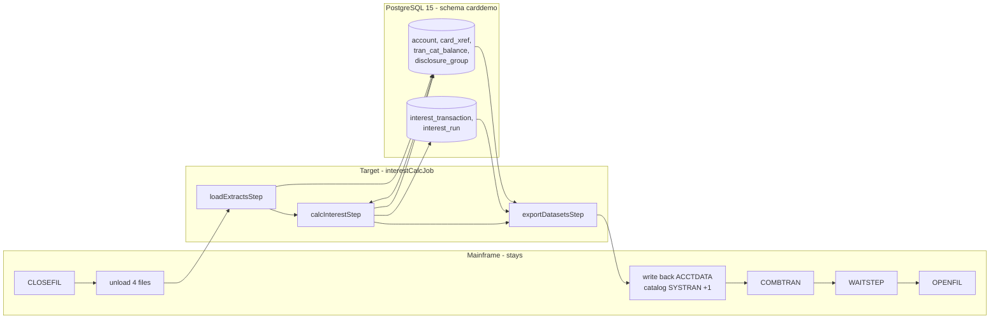

# Target architecture - interest stream (version 0.1.0)

<!-- Generated by modernization/design/tools/build_design.py - edit design_data.py or tickets_data.py and run `make design`. -->

> **PROPOSED - not approved.** Written by an agent from the code, the stream manifest and the rulebook. Every item names the role that has to confirm it.

| | |
|---|---|
| Repository | `Cognition-Partner-Workshops/ts-cobol-carddemo` |
| Stream root | `INTCALC` (`app/jcl/INTCALC.jcl` -> `app/cbl/CBACT04C.cbl`) |
| Baseline of the estate | `6face58c092d254a9b89ce8bbfbddce561720a40` (head of `demo/01-intake`; `app/`, `fixtures/`, `tools/` and `db/` are unchanged since) |
| Design based on | `18db1a56bbfd3d9c289395337e931af1df852637` (head of `demo/03-rules`) |
| Target | Java 21, Spring Batch 5 (Spring Boot 3), PostgreSQL 15 |
| architecture.md version | 0.1.0 |

This is the versioned golden copy. Tickets cite it by version; a change to a table owner, a boundary or a frozen
interface raises the version and is listed in the change log at the end.

## 1. What is being moved

One job step: `INTCALC.STEP15` runs `CBACT04C`, which reads the category balances (TCATBALF), looks up the account
(ACCTDATA), its card (CARDXREF) and its yearly rate (DISCGRP), writes one interest transaction per balance to a new
SYSTRAN generation and adds the interest to the account. Nothing else of the estate moves in this stream: the manifest
lists 111 other uses of the same datasets by jobs and CICS programs that stay on the mainframe.

## 2. Components

| Component | Spring Batch step | What it does | Writes | Reads | Needed only while neighbours stay on the mainframe |
|---|---|---|---|---|---|
| `interest-loader` | loadExtractsStep | Decodes the four unloaded files and replaces the four replica tables. Exists only while the inputs are owned by the mainframe. | account, card_xref, tran_cat_balance, disclosure_group (truncate and insert), interest_run (loaded counts and sums) | extract files | yes |
| `interest-calc` | calcInterestStep | The replacement of CBACT04C: one item is one account with all its category balances; computes interest, writes the interest transactions, updates the account and writes the run log (SYSOUT). | interest_transaction (insert), account (three columns), interest_run (written counts and sums), the run log file | tran_cat_balance, account, card_xref, disclosure_group | no |
| `interest-export` | exportDatasetsStep | Encodes the run's interest transactions as the SYSTRAN generation and the account table as the ACCTDATA image, with the return codes, in the recorded fixture format or the host format. | output files only | interest_transaction, account, interest_run | yes |
| `interest-run-control` | (listener on all steps) | Creates the interest_run row, records counts and sums after each step and the final status. Feeds the reconciliation report. | interest_run | - | no |
| `record-codec` | (library) | Copybook-driven encoder and decoder for fixed-length records: zoned decimals with overpunch signs, text in the host or the fixture code page, raw fillers. | - | app/cpy/*.cpy (read-only) | yes |
| `interest-policy` | (configuration) | One switch per open decision of the register. The default of each switch is the legacy behaviour; the code that depends on a decision reads the switch and cites the decision id. | - | application properties | no |

Layout of `java/interest` (names only; no code exists yet): `domain` (the calculation, no framework), `policy`
(the switches), `port` (interfaces of the calculation), `file` and `jdbc` (adapters of the ports), `codec`, `load`,
`export`, `recon`, `batch` (job and step configuration). The calculation depends on `port` and `policy` only.

## 3. Table ownership

One writer per table and column. `replica` means the mainframe file stays the system of record and the table is a copy
that is valid from one load to the write-back of the same run.

| Table | Layout | Legacy dataset | Kind | System of record | Who may write | Who reads |
|---|---|---|---|---|---|---|
| `carddemo.account` | CVACT01Y | AWS.M2.CARDDEMO.ACCTDATA.VSAM.KSDS | replica | mainframe (ACCTDATA) until the account writers move | interest-loader (truncate and load); interest-calc (UPDATE of acct_curr_bal, acct_curr_cyc_credit, acct_curr_cyc_debit only) | interest-calc, interest-export |
| `carddemo.card_xref` | CVACT03Y | AWS.M2.CARDDEMO.CARDXREF.VSAM.KSDS | replica | mainframe (CARDXREF) | interest-loader only | interest-calc |
| `carddemo.tran_cat_balance` | CVTRA01Y | AWS.M2.CARDDEMO.TCATBALF.VSAM.KSDS | replica | mainframe (TCATBALF, written by POSTTRAN) | interest-loader only | interest-calc |
| `carddemo.disclosure_group` | CVTRA02Y | AWS.M2.CARDDEMO.DISCGRP.VSAM.KSDS | replica | mainframe (DISCGRP, reloaded by job DISCGRP) | interest-loader only | interest-calc |
| `carddemo.interest_transaction` | CVTRA05Y | AWS.M2.CARDDEMO.SYSTRAN(+1) | owned | target (one set of rows per run = one SYSTRAN generation) | interest-calc only (INSERT) | interest-export |
| `carddemo.interest_run` | - | none (new control table) | owned | target | interest-run-control (one row per run; counts and sums per step) | interest-export, reconciliation report |
| `batch.* (Spring Batch job repository)` | - | none (framework tables) | framework | target | Spring Batch only | Spring Batch, operations |

Columns, types, keys and indexes: [data-map-interest.md](data-map-interest.md). The DDL goes to `db/postgres/02-interest.sql`
(ticket 02); `db/postgres/01-transaction-type.sql` is not changed.

## 4. Batch job boundary

* One Spring Batch job, `interestCalcJob`, replaces `INTCALC.STEP15`. It starts where the step started (after CLOSEFIL)
  and ends where it ended (before COMBTRAN). It does not take over any neighbour.
* Job parameters: `parmDate` (the ten characters of the PARM, INT-Q02), `runId` (new for every launch, so a second
  launch is a new run and is not refused - the legacy job has no such guard, INT-H02), `inputDir`, `outputDir`,
  `format` (`fixture` or `host`).
* Steps, in order: `loadExtractsStep` -> `calcInterestStep` -> `exportDatasetsStep`. The first and the last exist only
  because the files stay on the mainframe; they are removed when the neighbours move, without touching the middle step.
* The clock is injected. Tests and parity runs freeze it at the harness value `2022-07-05 10:00:00.00`.
* SYSOUT: the calculation writes the same lines CBACT04C displays (start line, every balance record as read, the two
  fallback messages, end line) to the run log `sysout/INTCALC.STEP15.txt`.

## 5. Transaction boundaries

| Step | Unit of work | What commits together | Legacy behaviour it replaces |
|---|---|---|---|
| `loadExtractsStep` | one table | TRUNCATE and all INSERTs of that table; then the counts and sums in `interest_run` | IDCAMS REPRO into an emptied cluster |
| `calcInterestStep` | a chunk of whole accounts (commit interval is a setting; default 100 accounts, see G11) | for each account of the chunk: the INSERTs of its interest transactions and the UPDATE of its three columns; then the step's restart state | none: CBACT04C has no commit; every REWRITE is final at once and WRITEs go to a sequential file |
| `exportDatasetsStep` | the whole export | files are written to a temporary directory and moved into place; then `interest_run.status = EXPORTED` | CLOSE of TRANSACT and the catalog of SYSTRAN(+1) at job end |

An account is never split across two transactions. The account that ends the input gets its transactions but, as coded,
no UPDATE (INT-Q04, switch `updateLastAccount`).

## 6. Restart boundaries

* `loadExtractsStep`: restart repeats the step. Loading twice gives the same tables.
* `calcInterestStep`: restart continues after the last committed account. The step saves, with each commit, the last
  account id, the transaction counter (the six digits of TRAN-ID), `seq_no` and the length of the run log; on restart
  the log is cut back to that length. A restarted run ends with the same rows as an uninterrupted one, except that
  records written after the restart carry the later clock (INT-Q03 as coded: the clock at the moment of the write).
* `exportDatasetsStep`: restart repeats the step; it changes no business table.
* This is a proposal (REL-11). The mainframe has no restart: a failed run leaves the accounts it had already
  rewritten, and the procedure for that is not in the estate (INT-H02, stream ask A4). Until REL-11 is answered the
  alternative - restore and rerun from the start - stays possible: abandon the run, reload, launch again.
* A failure never rolls back committed accounts and never skips an account: no skip, no retry.

## 7. Coexistence with the jobs that stay on the mainframe

The datasets are the interface. The record layouts of the five copybooks are frozen (FI-1); the target never talks to
VSAM directly and no mainframe job talks to PostgreSQL.

Who else uses the stream's datasets (from the manifest, 111 rows; setup jobs included):

| Dataset | Outside uses | Batch jobs that write, define or delete it | Batch jobs that only read or control it | CICS programs that write it | CICS programs that only read it |
|---|---|---|---|---|---|
| ACCTDATA.VSAM.KSDS | 40 | ACCTFILE, POSTTRAN | CBEXPORT, CLOSEFIL, CREASTMT, FEECALC, OPENFIL, READACCT | COACTUPC, COBIL00C | COACCT01, COACTVWC, COPAUA0C, COPAUS0C |
| CARDXREF.VSAM.AIX.PATH | 31 | XREFFILE | CLOSEFIL, OPENFIL | - | COACTUPC, COACTVWC, COBIL00C, COPAUS0C, COTRN02C |
| CARDXREF.VSAM.KSDS | 30 | XREFFILE | CBEXPORT, CLOSEFIL, CREASTMT, OPENFIL, POSTTRAN, READXREF, TRANREPT | - | COPAUA0C, COTRN02C |
| DISCGRP.VSAM.KSDS | 3 | DISCGRP | - | - | - |
| SYSTRAN | 2 | DEFGDGB | COMBTRAN | - | - |
| TCATBALF.VSAM.KSDS | 5 | POSTTRAN, TCATBALF | PRTCATBL | - | - |

Rules of coexistence (each PROPOSED; owner in brackets):

1. The mainframe files stay the system of record (REL-02). The four replica tables are replaced before every run and
   are not read by anything else. [data owner]
2. The run happens inside the existing window of the Control-M folder, between CLOSEFIL and OPENFIL, so the CICS
   programs that rewrite ACCTDATA (COACTUPC, COBIL00C) are shut out as today. That CLOSEFIL really closes the files
   before the next job is unproven (manifest U4, ask A7). [mainframe operations owner]
3. Between the unload and the write-back no mainframe job may write ACCTDATA. POSTTRAN does write it, and its order
   against INTCALC is not in either scheduler export (U2, ask A6, INT-H06). As a guard, the write-back replaces a
   record only if the record on the file still equals the image that was unloaded, and stops otherwise. [scheduler owner]
4. Only records of accounts the run updated are written back, whole (REL-03). TCATBALF, DISCGRP and CARDXREF are
   never written back. [mainframe application owner]
5. The exported transactions are cataloged as SYSTRAN(+1) by a mainframe step, so COMBTRAN's SYSTRAN(0) is this run's
   generation as today (U5). COMBTRAN, WAITSTEP and OPENFIL are unchanged and still wait on the same condition names
   (REL-09). [scheduler owner]
6. Jobs that read the files later (CREASTMT, CBEXPORT, FEECALC, READACCT, TRANREPT and others) see the result through
   the files, as today. [mainframe application owner]
7. The unload, backup, transfer and write-back are mainframe-side steps. They are described in
   [strategy-interest.md](strategy-interest.md) (CO2) and are not built by the tickets of this stream. [mainframe operations owner]

## 8. Policy switches

Every open decision of the register is implemented as the legacy behaviour behind one switch, read in one class
(`interest-policy`). Changing an answer later is a change of one default and of the tests named by that id.

| Decision | Switch | Default (legacy behaviour) | Other values | Where it applies |
|---|---|---|---|---|
| INT-Q01 | `interest.policy.rounding` | TRUNCATE | HALF_UP, HALF_EVEN | interest-calc, amount calculation |
| INT-Q02 | `interest.policy.idPrefix` | PARM | RUN_DATE | interest-calc, transaction id |
| INT-Q03 | `interest.policy.timestampSource` | RUN_CLOCK | CYCLE_DATE | interest-calc, both timestamps |
| INT-Q04 | `interest.policy.updateLastAccount` | false | true | interest-calc, account break at end of input |
| INT-Q05 | `interest.policy.negativeBalance` | CHARGE | SKIP | interest-calc, per balance |
| INT-Q06 | `interest.policy.zeroInterest` | WRITE | SKIP | interest-calc, per balance |
| INT-H01 | `(none - empty fee hook)` | no fee | a fee rule from the business | interest-calc, after the interest of a balance |
| INT-H02 | `interest.policy.rerunGuard` | OFF | REFUSE_SAME_PARM | job launch |
| INT-H03 | `interest.policy.multiCard` | STOP (proposed - the source does not determine it) | FIRST_BY_CARD_NUM | interest-calc, card lookup |
| INT-H04 | `interest.policy.inactiveAccounts` | CHARGE | SKIP | interest-calc, per account |
| INT-H05 | `interest.policy.overflow` | STOP (proposed - the source does not determine it) | WIDEN | interest-calc, amount and counter |
| INT-H06 | `(none - scheduler order)` | the order of the Control-M folder as exported | another order stated by operations | outside the job |

INT-H03 and INT-H05 have no legacy behaviour the source determines; the proposed default stops the run instead of
inventing a card number or cutting digits off. Both stay OPEN in the register.

## 9. Frozen shared interfaces

| Id | Interface | Where | Frozen by |
|---|---|---|---|
| FI-1 | Record layouts | app/cpy/CVACT01Y.cpy, CVACT03Y.cpy, CVTRA01Y.cpy, CVTRA02Y.cpy, CVTRA05Y.cpy | the estate |
| FI-2 | Recorded output format and comparator | fixtures/interest/&lt;case&gt;/expected (datasets/&lt;DSN&gt;.txt, sysout/INTCALC.STEP15.txt, rc.json, manifest.json) and tools/parity/compare.py | the estate |
| FI-3 | Ports of the calculation | java/interest: package com.carddemo.interest.port (BalanceSource, AccountStore, CardLookup, RateLookup, TransactionSink, RunLog) | ticket 01, once merged |
| FI-4 | Schema | `db/postgres/02-interest.sql` | ticket 02, once merged |
| FI-5 | Policy switch names | architecture.md, section Policy switches (interest.policy.*) | architecture.md 0.1.0 |
| FI-6 | Parity entry point | make parity-java [CASE=&lt;case&gt;], output under work/parity-java/&lt;case&gt;/actual | ticket 01, once merged |

## 10. Not decided here

* Business rules: `modernization/rules/interest/decisions.md` (12 rows, all OPEN).
* Release and coexistence choices: [decisions-release.md](decisions-release.md) (13 rows, all OPEN).
* Mapping gaps: [data-map-interest.md](data-map-interest.md) (12 gaps).

## Change log

| Version | Change |
|---|---|
| 0.1.0 | First proposal. |
