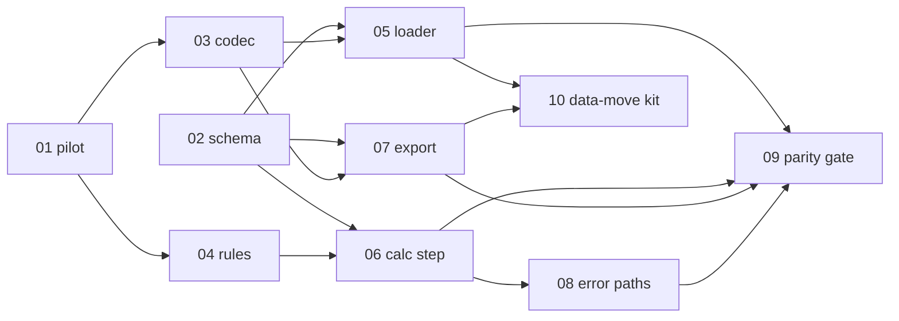

# Ticket queue - interest stream

<!-- Generated by modernization/design/tools/build_design.py - edit design_data.py or tickets_data.py and run `make design`. -->

> **PROPOSED - not approved.** Written by an agent from the code, the stream manifest and the rulebook. Every item names the role that has to confirm it.

| | |
|---|---|
| Repository | `Cognition-Partner-Workshops/ts-cobol-carddemo` |
| Stream root | `INTCALC` (`app/jcl/INTCALC.jcl` -> `app/cbl/CBACT04C.cbl`) |
| Baseline of the estate | `6face58c092d254a9b89ce8bbfbddce561720a40` (head of `demo/01-intake`; `app/`, `fixtures/`, `tools/` and `db/` are unchanged since) |
| Design based on | `18db1a56bbfd3d9c289395337e931af1df852637` (head of `demo/03-rules`) |
| Target | Java 21, Spring Batch 5 (Spring Boot 3), PostgreSQL 15 |
| architecture.md version | 0.1.0 |

10 bounded engineering tickets. Each follows the same contract (work item, source, context, scope,
dependencies, acceptance, verification, deliverables, ticket writes, restrictions). Business and release decisions are
not tickets: they are in `modernization/rules/interest/decisions.md` and [../decisions-release.md](../decisions-release.md).
An open QUIRK is built as the legacy behaviour and cited by id.

No ticket has been created in any external system and no implementation session has been started.

## The pilot

**Ticket [01-pilot-thin-slice](01-pilot-thin-slice.md) is the pilot.** It is a thin end-to-end slice with no dependencies: read the input
files of one case, compute interest on the simplest path, write the outputs. Its result can already be compared with
the estate's comparator on the fixture case `i01-baseline`. It also fixes the ports (FI-3) and the parity entry point
(FI-6) the later tickets build on.

## Dependency order

| Ticket | Title | Starts after | Group |
|---|---|---|---|
| [01-pilot-thin-slice](01-pilot-thin-slice.md) | Pilot: thin end-to-end slice on i01-baseline | nothing | Pilot - starts first, no dependencies |
| [02-schema](02-schema.md) | Schema for the interest stream | nothing | Schema - no dependencies, can start in parallel with the pilot |
| [03-record-codec](03-record-codec.md) | Record codec for the five copybooks | 01 | After the pilot - can run in parallel with each other and with the schema |
| [04-calculation-rules](04-calculation-rules.md) | Complete calculation rules behind the policy switches | 01 | After the pilot - can run in parallel with each other and with the schema |
| [05-extract-loader](05-extract-loader.md) | Loader for the four unloaded files with reconciliation figures | 02, 03 | Waits on the schema |
| [06-calc-step-jdbc](06-calc-step-jdbc.md) | Calculation step on PostgreSQL with commit and restart boundaries | 02, 04 | Waits on the schema |
| [07-dataset-export](07-dataset-export.md) | Export of SYSTRAN, the ACCTDATA image and return codes | 02, 03 | Waits on the schema |
| [08-error-paths](08-error-paths.md) | Error paths and stop conditions | 06 | Waits on the schema |
| [09-parity-gate](09-parity-gate.md) | Gate: seven-case parity through the database, in CI | 05, 06, 07, 08 | Final gate |
| [10-data-move-kit](10-data-move-kit.md) | Gate: reconciliation report and side-by-side comparison kit | 05, 07 | Final gate |

* **Can start in parallel, at once:** 01 (pilot) and 02 (schema). Neither depends on anything.
* **Can start in parallel once the pilot is merged:** 03, 04. They do not wait on the schema.
* **Wait on the schema (ticket 02):** 05, 06, 07, 08. Of these, 05 and 07 also need the codec (03), 06 also needs the rules (04), and 08 needs 06.
* **Final gates:** 09, 10. Ticket 09 closes only when all seven fixture cases pass through the database in CI; ticket 10 closes when the reconciliation and side-by-side reports can be produced. Neither changes product code; a defect found at a gate goes back to the ticket that owns the code.

## Shared rules of every ticket

* Frozen interfaces are listed in `architecture.md`, section 9. A ticket that needs one changed stops and reports it as a gap.
* No edits to `app/` or `fixtures/*/expected`; no merge or deploy; one branch and one pull request per ticket.
* A ticket does not write to tickets (its own or others); what it could not do goes into the pull request as a gap.
