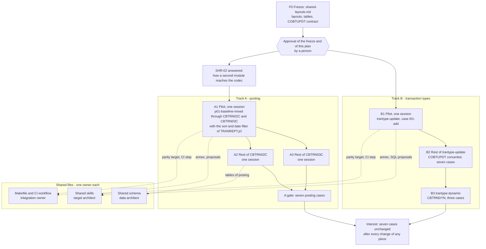

# Parallel tracks - plan of the hand-off from interest (version 1.0.0)

> **PROPOSED - not approved. Open this file first.** Written by an agent in step 7 from the source on
> `demo/06-lab` at `d39ebac`. No Java was written, `app/` and `fixtures/` were not edited, and **no session was
> started for any track.** Work starts only after a person approves this plan and the freeze.
> **Owner who must confirm: the delivery lead, with the target architect.**

Read with it: [shared-layouts.md](shared-layouts.md) (the freeze) and the three hand-offs,
[posting](../streams/posting/handoff.md), [trantype-update](../streams/trantype-update/handoff.md),
[trantype-dynamic](../streams/trantype-dynamic/handoff.md).

Track A - Ticket writes: prohibited

Track B - Ticket writes: prohibited

The presenter has authorized no tracker, so no project and no transitions are named. The tickets are the files
under `modernization/design/tickets/<stream>/`; no ticket was created in any external system.

## 1. The two tracks

| Track | Streams, in order | Jobs | Programs |
|---|---|---|---|
| A - posting | `posting` | `app/jcl/POSTTRAN.jcl`, then `app/jcl/TRANREPT.jcl` | `CBTRN02C`, then `CBTRN03C` |
| B - transaction types | `trantype-update`, then `trantype-dynamic` | `MNTTRDB2.jcl`, then `MNTTRDYN.jcl` (both under `app/app-transaction-type-db2/jcl`) | `COBTUPDT`; then `CBTRNDYN`, which calls `COBTUPDT` by a name held in a variable |

The tracks share no program and no file they write. They meet in one place: the report of Track A reads two
files that are unloaded from the tables of Track B (`posting/handoff.md`, section 6). Neither track changes
that link.

## 2. The freeze and both tracks

Solid arrows are "waits for". Dotted arrows are proposals to the owner of a shared file: the piece of work does
not wait for the owner's edit and does not make the edit itself.

| Piece | Waits for | Reason |
|---|---|---|
| F0 freeze | nothing | it is this pull request |
| A1 | approval; SHR-02 answered | four of posting's layouts are decoded by a codec that lives in `java/interest`; A1 may not copy or edit it |
| A2, A3 | A1 merged | A1 fixes the module layout, the interface between the two programs and the stream's skills |
| B1 | approval | it uses nothing of interest's module or schema |
| B2 | B1 merged | B1 fixes the module layout and the stream's skills |
| B3 | B2 merged, the seven `t` cases passing | every `d` case runs `COBTUPDT`; `d01` needs its add path, `d03` its update and error paths |
| A gate | A2 and A3 merged | the seven cases need both programs complete |

## 3. Track A

**A1 - pilot, one session, a thin slice across both programs.** Case `fixtures/posting/p01-baseline-mixed`:
four valid transactions posted by `CBTRN02C`, then reported by `CBTRN03C` after the unload, the date filter
(`TRAN-PROC-TS` date between `2022-01-01` and `2022-07-06`) and the sort by card number of `TRANREPT.jcl:23-55`.
One session, because the slice crosses the one interface inside the stream: what the first program writes to
`TRANSACT` is what the second reads. File adapters only; no table of `02-interest.sql` is written (SHR-01).
Ticket: [tickets/posting/01-pilot-thin-slice.md](tickets/posting/01-pilot-thin-slice.md).

**Then the rest of each program, one program per session, in parallel.**

* A2 - the rest of `CBTRN02C`: the four reject reasons, the reject file, return code 4, creation of a category
  balance, the empty day, the error paths. Ticket: [tickets/posting/02-cbtrn02c-rest.md](tickets/posting/02-cbtrn02c-rest.md).
* A3 - the rest of `CBTRN03C`: the report on what a run with rejects leaves, the page total, the totals at end
  of file, the empty report, the lookups that abend. Ticket: [tickets/posting/03-cbtrn03c-rest.md](tickets/posting/03-cbtrn03c-rest.md).

A2 and A3 can run in parallel because they own different packages of `java/posting` and A1 has frozen the
interface between them. A3 does not wait for A2: until A2 is merged it reads the recorded `TRANSACT` file of
each case (`expected/datasets/AWS.M2.CARDDEMO.TRANSACT.VSAM.KSDS.txt`) as its input. The seven cases end to end
are the gate after both.

## 4. Track B

**B1 - pilot, one session, `trantype-update`, case `t01-add`.** Two inserts through the converted `COBTUPDT`,
committed once at the end, with the SYSOUT lines, the return code and the two table snapshots of the case.
Ticket: [tickets/trantype-update/01-pilot-t01-add.md](tickets/trantype-update/01-pilot-t01-add.md).

**B2 - the rest of `trantype-update`:** update, delete, comment lines, the missing row (`t05`), the duplicate
(`t06`), the mixed file. After B2, `COBTUPDT` is converted.
Ticket: [tickets/trantype-update/02-cobtupdt-rest.md](tickets/trantype-update/02-cobtupdt-rest.md).

**B3 - `trantype-dynamic`, only once `COBTUPDT` is converted:** `CBTRNDYN` with the dynamic statement and the
call by name, on the three `d` cases. Ticket:
[tickets/trantype-dynamic/01-cbtrndyn.md](tickets/trantype-dynamic/01-cbtrndyn.md).

Track B is a line, not a fan: one engineer at a time.

## 5. A stream's skills come from its pilot

The pilot writes the stream's annex (`.agents/skills/carddemo-stream-<stream>/SKILL.md`) from what it built and
ran, and proposes changes to the shared skills; it does not edit them. Each later session adds to its annex what
it proved. What each pilot **leaves out** of the skills, because its slice does not reach it:

| Pilot | Its skills cover | Its skills leave out - added by |
|---|---|---|
| A1 (`p01-baseline-mixed`) | build and verify for `java/posting`; the valid path of `CBTRN02C`; the report's detail line, account total, page and grand total as `p01` prints them; the utility steps as converted; proves or corrects the draft annex for the rows it touched | reject reasons 100 to 103, the reject file, return code 4 (A2); creation of a category balance and negative amounts (A2); the empty day (A2, A3); a page break inside a report (no case has more than 20 lines); the abend paths of both programs; `NEXT SENTENCE` (no case reaches it); the database steps and anything about SHR-01; the host code page |
| B1 (`t01-add`) | build and verify for `java/trantype-update`; INSERT with host variables, the padded description, the single commit, the launcher lines; proposals for the SQL standards | UPDATE and DELETE (B2); every SQLCODE other than zero, return code 4 (B2: `t05`, `t06`); comment lines and the mixed file (B2); dynamic SQL and the call by name - written by B1 as proposals from the source only, proven by B3; the plan and package, which nothing off-host stands for |
| none for `trantype-dynamic` | it starts from the annex of `trantype-update` and writes its own annex in B3 | - |

Until a pilot is merged, its stream has no proven skill. The draft annex of posting stays a draft until A1.

## 6. Ownership - one row per piece of work

| Piece | Track | Stream | Programs | Java module | Branch prefix | Cases to pass | Waits for | Must not touch |
|---|---|---|---|---|---|---|---|---|
| F0 | both | all | none | none | `demo/07-handoff` | none (documents) | nothing | `app/`, `fixtures/`, `java/`, skills, generated design files |
| A1 | A | posting | `CBTRN02C`, `CBTRN03C` (valid path) | `java/posting` (new) | `posting/01-pilot` | `p01-baseline-mixed`; interest 7 unchanged | approval; SHR-02 | `java/interest`, `db/postgres/`, `Makefile`, CI workflow, shared skills, `app/`, `fixtures/`, `tools/`, Track B |
| A2 | A | posting | `CBTRN02C` | `java/posting`, the packages of `CBTRN02C` only | `posting/02-cbtrn02c` | `p01` to `p07`, the outputs of POSTTRAN (three datasets, `sysout/POSTTRAN.STEP15.txt`, `STEP15`); interest 7 unchanged | A1 merged | the packages of `CBTRN03C`; everything A1 must not touch |
| A3 | A | posting | `CBTRN03C`, the REPRO and SORT steps | `java/posting`, the packages of `CBTRN03C` only | `posting/03-cbtrn03c` | `p01` to `p07`, the outputs of TRANREPT (the report, `sysout/TRANREPT.STEP10R.txt`, its return codes); interest 7 unchanged | A1 merged | the packages of `CBTRN02C`; everything A1 must not touch |
| A gate | A | posting | both | none (no product code) | `posting/04-gate` | all seven posting cases end to end; interest 7 unchanged | A2 and A3 merged | product code: a defect goes back to A2 or A3 |
| B1 | B | trantype-update | `COBTUPDT` (INSERT path) | `java/trantype-update` (new) | `trantype-update/01-pilot` | `t01-add`; interest 7 unchanged | approval | `db/postgres/`, `java/interest`, `Makefile`, CI workflow, shared skills, `app/`, `fixtures/`, `tools/`, `CBTRNDYN`, Track A |
| B2 | B | trantype-update | `COBTUPDT` | `java/trantype-update` | `trantype-update/02-rest` | `t01` to `t07`; interest 7 unchanged | B1 merged | as B1; the frozen contract of `shared-layouts.md` 3.3 |
| B3 | B | trantype-dynamic | `CBTRNDYN` (calls `COBTUPDT`) | `java/trantype-dynamic` (new), depends on `java/trantype-update` | `trantype-dynamic/01-cbtrndyn` | `d01` to `d03`; `t01` to `t07` unchanged; interest 7 unchanged | B2 merged | `java/trantype-update` (asks its owner), and as B1 |

Branches start from the integration branch the delivery lead names at approval (this plan was written on
`demo/07-handoff`). One branch and one pull request per piece; nobody merges their own.

## 7. One owner for each file every track touches

| File | Owner | How another track gets a change |
|---|---|---|
| `Makefile` | integration owner (one named person, in neither track) | the track's pull request carries a section "Proposed for the Makefile" with the exact lines. Until the owner adds them, the stream proves itself with a script inside its own module that calls `tools/parity/compare.py` |
| `.github/workflows/parity.yml` | integration owner | same section, "Proposed for CI". The owner adds one step per stream after the stream's gate |
| `docker-compose.yml`, `Dockerfile` | integration owner | same |
| Shared skills: `.agents/skills/carddemo-conversion-standards`, `carddemo-ticket-build`, `carddemo-ticket-verify`, `carddemo-pitfalls`, `carddemo-parity` | target architect | the track proposes in its pull request and in its own annex; the owner edits the shared skill in a pull request of their own |
| Shared schema: `db/postgres/01-transaction-type.sql`, `db/postgres/02-interest.sql` | data architect | a register row in `shared-layouts.md` section 6. A stream's own tables go in a new script of its own, reviewed by the data architect; it alters no existing table |
| `modernization/design/shared-layouts.md`, this file | delivery lead with the target architect | a register row, then a new version |
| `AGENTS.md` | integration owner | proposed in the pull request |
| `tools/`, `fixtures/`, `app/` | the estate | nobody changes them |

A stream's own files have their stream as owner: `java/<stream>/`, `modernization/rules/<stream>/`,
`modernization/streams/<stream>/`, `modernization/design/tickets/<stream>/`, `.agents/skills/carddemo-stream-<stream>/`.

## 8. How many engineers, stage by stage

"Engineer" is a person driving one session at a time. The integration owner is counted apart: one person, part
time, at every stage after the freeze.

| Stage | Work in progress | Engineers at once | Why not more |
|---|---|---|---|
| 0 | F0 freeze and approval | 1 | one document set, one approval |
| 1 | A1 and B1 | 2 | each pilot is one session by design: it fixes the stream's layout and skills |
| 2 | A2, A3 and B2 | 3 | Track B is a line |
| 3 | A gate; B3 | 2 | B3 needed B2; the gate needed A2 and A3 |

At most three engineers, plus the integration owner. If A1 is delayed by SHR-02, B1 starts alone.

**What cannot run in parallel, and why**

| Not in parallel | Reason |
|---|---|
| A1 split over two sessions | the slice exists to fix the interface between `CBTRN02C` and `CBTRN03C` and the stream's skills in one place |
| A2 or A3 with A1 | they build on A1's module layout, interface and annex |
| B2 with B1 | same program, same module, same files |
| B3 with B1 or B2 | `CBTRNDYN` calls `COBTUPDT`; all three `d` cases run it, and its contract (`shared-layouts.md` 3.3) is only proven when the seven `t` cases pass |
| Two edits of a shared file | one owner each (section 7); two tracks editing the `Makefile` or the CI workflow would conflict, and a wrong CI step breaks every stream |
| Two parity runs on one machine | every chain rewrites `datasets/` and `work/`, and both trantype chains and `make parity-java` reseed tables of the one `db` service. Each engineer works in their own checkout with their own containers |
| A combined run of posting then interest | the order is not proven (SHR-07); each stream is proven on its own cases only |

## 9. What each stream must pass

The legacy side first: `make parity` reruns all 24 cases of the four chains against the golden files and must
stay green on every branch. A converted stream is proven case by case with
`python3 tools/parity/compare.py <stream> <case> --actual <dir> --label java`.

| Stream | Cases | Count |
|---|---|---|
| posting | `p01-baseline-mixed`, `p02-invalid-card`, `p03-account-missing`, `p04-overlimit-reject`, `p05-expired-account`, `p06-credits-new-category`, `p07-empty-day` | 7 |
| trantype-update | `t01-add`, `t02-update`, `t03-delete`, `t04-comments`, `t05-delete-missing`, `t06-duplicate-add`, `t07-mixed-batch` | 7 |
| trantype-dynamic | `d01-update-then-apply`, `d02-delete-statement`, `d03-bad-statement` | 3 |

**After every change, by any piece of work, all seven interest cases unchanged:** `i01-baseline`,
`i02-tie-half-cent`, `i03-zero-rate-skipped`, `i04-default-group-fallback`, `i05-multi-category`,
`i06-negative-balance`, `i07-nontie-rounding`. Proven by `make parity CHAIN=interest` (legacy against golden) and
`make parity-java` (the Java job, seven of seven), and by an empty
`git diff <base> -- java/interest db/postgres/02-interest.sql fixtures app tools lab`.

What each case proves: section 7 of the posting hand-off, section 5 of the two trantype hand-offs.

## 10. What is not handed off

| Not handed off | What is there | What it would need first |
|---|---|---|
| Batch jobs with no chain and no recorded output: `CREASTMT` (`CBSTM03A`, `CBSTM03B`), `COMBTRAN`, `TRANBKP`, `PRTCATBL`, the print jobs `READACCT`, `READCARD`, `READCUST`, `READXREF` (`CBACT01C`, `CBACT02C`, `CBCUS01C`, `CBACT03C`), `CBTRN01C` (no job runs it), `TRANEXTR`, `CBPAUP0J` (of the authorization sub-application) | the programs compile off-host but run in no chain (`docs/BASELINE.md`); `CBSTM03A` uses `ALTER` and `GO TO` and calls `CBSTM03B`; `TRANEXTR` needs `DSNTIAUL` | a chain in `tools/runjcl/chains.json`, fixture cases with golden output recorded by `make record` on a person's request, and stand-ins for what the harness lacks (`COBSWAIT`/`MVSWAIT` for the statements, `DSNTIAUL` for TRANEXTR). Then the same steps as interest: stream, rules, design |
| `CBEXPORT`, `CBIMPORT` | do not compile: a field no shipped copybook declares (`docs/BASELINE.md`) | the missing copybook from the estate's owner |
| The online programs: 19 under `app/cbl/CO*`, `COTRTLIC` and `COTRTUPC` of the Db2 application, and the two other sub-applications (`app/app-authorization-ims-db2-mq`, `app/app-vsam-mq`) | analysis-only: no CICS region, no BMS maps, no IMS, no MQ off-host | a way to run or replay a transaction with recorded screens and file states, a parity definition for a conversation, and a target design for the online side. None exists |
| HLASM: `app/asm/COBDATFT.asm`, `app/asm/MVSWAIT.asm`, macros in `app/maclib` | analysis-only, no assembler; described in `docs/LEGACY-LANGUAGES.md` | their callers handed off first (`CBACT01C`, the statement chain); recorded input and output of each routine from the host, or an assembler |
| PL/I: `app/pli/CBFEECAL.pli`, its caller `CBFEEDRV`, job `FEECALC` | analysis-only, no PL/I compiler; `CBFEEDRV` compiles but cannot run | recorded input and output of the fee calculation from the host, or a compiler; then a chain and cases |
| The link jobs between the tracks: `TRANEXTR`, `TRANTYPE`, `TRANCATG` | `posting/handoff.md`, section 6 | the answer to ask PA-4, then a decision whether the report reads the tables |
| The scheduler definitions | `app/scheduler` | the answers to SHR-07, PA-6, TD-4 |

## 11. Before work starts

1. A person approves `shared-layouts.md` and this plan, or returns them with changes.
2. The delivery lead names the integration branch, the integration owner and the engineers.
3. The target architect answers SHR-02 (Track A cannot start without it).
4. Only then is a session started for A1 or B1. None has been started.
