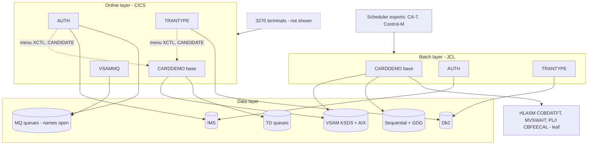
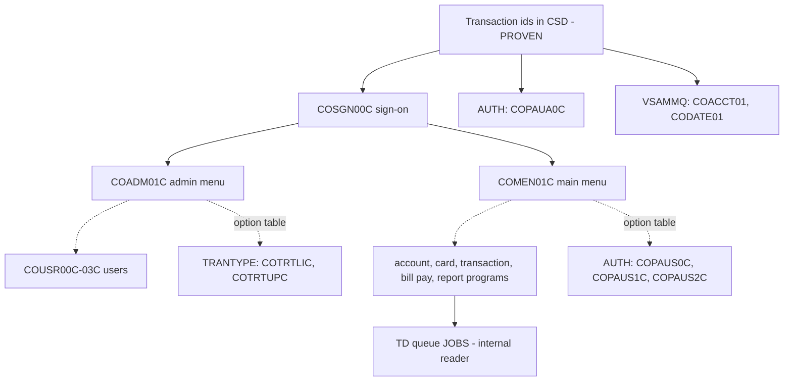
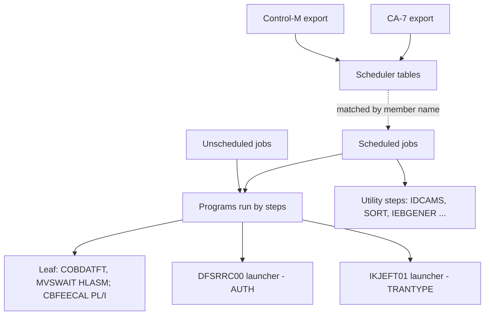
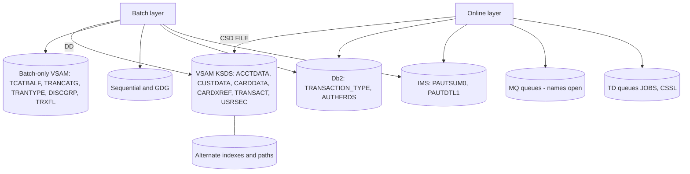

# As-is architecture - CardDemo legacy estate

Baseline `a5da4ee6bb4261392ac0a44a0756b82914b97fe8` (`main`). Companion: `architecture-as-is.html` (diagrams, same content). Generated by `modernization/legacy/tools/build_architecture.py` from Parts A-D.

## 1. Scope and sources

**Figure 1 - the estate**

This describes the estate as the repository shows it at baseline `a5da4ee6bb4261392ac0a44a0756b82914b97fe8`. It proposes no target.

Sources: **Part A** `modernization/INTAKE.md` (what is supplied, absent, and what runs); **Part B** `modernization/legacy/fan-out.md` and the mftb 0.2.1 stores under `store/`; **Part C** `INTAKE.md` sections 5 and 6 (scanner checks and open questions); **Part D** `modernization/legacy/call-graph.md` and `call-graph.json` (1179 edges).

Status words are those of Part D: PROVEN (static, cited), CANDIDATE (dynamic or inferred), OPEN (an ask). Module names are the proposed names of the frozen map `store/modules.json` (Part B).

| Measure | Value | Source |
|---|---|---|
| Programs | 49 (25 online, 18 run by JCL steps, 2 called subroutines, 3 HLASM / PL/I leaf, 1 reached by nothing) | Part D sections 1, 2, 7 |
| Transactions | 25 | Part D section 5 |
| Jobs | 48 (21 scheduled, 27 unscheduled) | Part D sections 2, 6 |
| BMS mapsets | 21 source members; 21 mapsets used by programs | Part A section 2; Part D section 3 |
| Stores with a PROVEN program access | 43 | Part D section 3.1 |
| Stores touched by both layers | 8 | section 6 below |
| Cross-module program edges | 7, all CANDIDATE | Part D section 1.3 |
| Open asks in the graph | 31 | Part D sections 1.4, 3.4 |
| Open asks in the estate roll-up | 53 | Part B; `store/estate.json` |

## 2. Online layer

**Figure 2 - online layer**

Dashed = CANDIDATE.

CICS pseudo-conversational COBOL programs with BMS maps. A program is counted as online when the scan found `EXEC CICS` commands in it (`store/<MODULE>/connections.json`, Part B). None of them runs off-host (Part A section 3).

| Module | Source root | Online programs | Transactions | Mapsets used |
|---|---|---|---|---|
| CARDDEMO | app (base) | 17: COACTUPC, COACTVWC, COADM01C, COBIL00C, COCRDLIC, COCRDSLC, COCRDUPC, COMEN01C, CORPT00C, COSGN00C, COTRN00C, COTRN01C, COTRN02C, COUSR00C, COUSR01C, COUSR02C, COUSR03C | CA00 to COADM01C, CAUP to COACTUPC, CAVW to COACTVWC, CB00 to COBIL00C, CC00 to COSGN00C, CCDL to COCRDSLC, CCLI to COCRDLIC, CCUP to COCRDUPC, CDV1 to COCRDSEC, CM00 to COMEN01C, CR00 to CORPT00C, CT00 to COTRN00C, CT01 to COTRN01C, CT02 to COTRN02C, CU00 to COUSR00C, CU01 to COUSR01C, CU02 to COUSR02C, CU03 to COUSR03C | 17 |
| AUTH | app/app-authorization-ims-db2-mq | 4: COPAUA0C, COPAUS0C, COPAUS1C, COPAUS2C | CP00 to COPAUA0C, CPVD to COPAUS1C, CPVS to COPAUS0C | 2 |
| TRANTYPE | app/app-transaction-type-db2 | 2: COTRTLIC, COTRTUPC | CTLI to COTRTLIC, CTTU to COTRTUPC | 2 |
| VSAMMQ | app/app-vsam-mq | 2: COACCT01, CODATE01 | CDRA to COACCT01, CDRD to CODATE01 | 0 |

Entry: every transaction id maps to one initial program in a CSD `DEFINE TRANSACTION` (PROVEN, Part D section 5). `CDV1` names program `COCRDSEC`, which is not in the estate (Part D section 5).

Navigation: programs pass control with `EXEC CICS XCTL` through a COMMAREA field or a menu option table, so program-to-program navigation is CANDIDATE, not PROVEN (69 CANDIDATE edges, Part D section 1.2), and 14 transfer targets are OPEN (Part D section 1.4).

Online to batch hand-off: `CORPT00C` writes JCL records to TD queue `JOBS`, defined in the CSD as an internal reader (Part D section 3.1 and 3.3; `app/cbl/CORPT00C.cbl:517`, `app/csd/CARDDEMO.CSD:499`).

## 3. Batch layer

**Figure 3 - batch layer**

JCL jobs under `app/jcl` and `app/app-*/jcl`, two procedures under `app/proc`, and two scheduler exports under `app/scheduler` (Part A section 2). Four chains run off-host under the harness: posting, interest, trantype-update, trantype-dynamic (Part A section 4).

| Module | Jobs | Scheduled | Programs run by steps | Called subroutines |
|---|---|---|---|---|
| CARDDEMO | 39 | 18 | 12: CBACT01C, CBACT02C, CBACT03C, CBACT04C, CBCUS01C, CBEXPORT, CBFEEDRV, CBIMPORT, CBSTM03A, CBTRN02C, CBTRN03C, COBSWAIT | CBSTM03B, CSUTLDTC |
| AUTH | 5 | 1 | 4: CBPAUP0C, DBUNLDGS, PAUDBLOD, PAUDBUNL | - |
| TRANTYPE | 4 | 2 | 2: CBTRNDYN, COBTUPDT | - |

Launchers: AUTH batch programs run under `DFSRRC00` (IMS region controller) and TRANTYPE batch programs under `IKJEFT01` (`DSN RUN`); the scan resolves the program from the step's PARM or SYSTSIN (PROVEN, Part D section 2).

| Scheduler table | Dialect | Jobs | Order |
|---|---|---|---|
| CARDDEMO | ca7-ljob | CLOSEFIL, CBPAUP0J, POSTTRAN, WAITSTEP, OPENFIL, TRANTYPE, CLOSEFIL1, CLOSEFIL2, TRANCATG, TCATBALF, READACCT, READCARD, READCUST, READXREF, CREASTMT, TXT2PDF1, PRTCATBL | WAITSTEP then CLOSEFIL; OPENFIL then CLOSEFIL; CLOSEFIL then CBPAUP0J; CBPAUP0J then POSTTRAN; POSTTRAN then WAITSTEP; TRANTYPE then WAITSTEP; TRANCATG then WAITSTEP; TCATBALF then WAITSTEP; READXREF then WAITSTEP; TXT2PDF1 then WAITSTEP; PRTCATBL then WAITSTEP; WAITSTEP then OPENFIL; WAITSTEP then OPENFIL; CLOSEFIL then TRANTYPE; WAITSTEP then CLOSEFIL1; WAITSTEP then CLOSEFIL2; CLOSEFIL1 then TRANCATG; CLOSEFIL2 then TCATBALF; CLOSEFIL then READACCT; READACCT then READCARD; READCARD then READCUST; READCUST then READXREF; CLOSEFIL then CREASTMT; CREASTMT then TXT2PDF1; CLOSEFIL then PRTCATBL |
| DAILY-TransactionBackup | controlm-xml | CLOSEFIL, TRANBKP, WAITSTEP, OPENFIL | CLOSEFIL then TRANBKP; TRANBKP then WAITSTEP; WAITSTEP then OPENFIL |
| WEEKLY-TransactionTypesDBRefresh | controlm-xml | MNTTRDB2 | single job |
| DisclosureGroupsRefresh | controlm-xml | CLOSEFIL, DISCGRP, WAITSTEP, OPENFIL | CLOSEFIL then DISCGRP; DISCGRP then WAITSTEP; WAITSTEP then OPENFIL |
| TransactionTypesDBRefresh | controlm-xml | TRANEXTR | single job |
| MONTHLY-InterestCalculation | controlm-xml | CLOSEFIL, INTCALC, COMBTRAN, WAITSTEP, OPENFIL | CLOSEFIL then INTCALC; INTCALC then COMBTRAN; COMBTRAN then WAITSTEP; WAITSTEP then OPENFIL |

27 of 48 jobs are named by neither export (Part D section 6, unscheduled). Whether they are run by hand, on request, or once at set-up is not shown by the repository.

`CBTRN01C` is reached by no job, call or transaction and its files are bound by no JCL (Part D section 7).

## 4. Data layer

**Figure 4 - data layer**

Stores with at least one PROVEN program access (Part D section 3.1): 3 Db2 table, 5 GDG generation, 2 IMS segment, 2 TD queue, 11 VSAM, 2 VSAM path (alternate index), 18 sequential / other. Utility-step datasets are in Part D section 3.2.

**Owner** below means the layer whose programs write or update the store in PROVEN edges. It describes the code; it is not a statement of who governs the data, which the repository does not show.

| Store | Kind | Owner (writes) | Online programs | Batch programs | First citation |
|---|---|---|---|---|---|
| CARDDEMO.AUTHFRDS | Db2 table | online | COPAUS2C (writes+updates) | - | `app/app-authorization-ims-db2-mq/cbl/COPAUS2C.cbl:141-198` |
| CARDDEMO.TRANSACTION_TYPE | Db2 table | both layers write | COTRTLIC (reads+updates), COTRTUPC (reads+writes+updates) | COBTUPDT (writes+updates) | `app/app-transaction-type-db2/dcl/DCLTRTYP.dcl:28-31` |
| SYSIBM.SYSDUMMY1 | Db2 table | no program writes it in the scan | COTRTLIC (reads) | - | `app/app-transaction-type-db2/cpy/CSDB2RPY.cpy:23-28` |
| AWS.M2.CARDDEMO.DALYREJS(+1) | GDG generation | batch | - | CBTRN02C (writes) | `app/cbl/CBTRN02C.cbl:46` |
| AWS.M2.CARDDEMO.LATEFEES(+1) | GDG generation | batch | - | CBFEEDRV (writes) | `app/cbl/CBFEEDRV.cbl:37` |
| AWS.M2.CARDDEMO.SYSTRAN(+1) | GDG generation | batch | - | CBACT04C (writes) | `app/cbl/CBACT04C.cbl:53` |
| AWS.M2.CARDDEMO.TRANREPT(+1) | GDG generation | batch | - | CBTRN03C (writes) | `app/cbl/CBTRN03C.cbl:51` |
| AWS.M2.CARDDEMO.TRANSACT.DALY(+1) | GDG generation | no program writes it in the scan | - | CBTRN03C (reads) | `app/cbl/CBTRN03C.cbl:29` |
| IMS segment PAUTDTL1 | IMS segment | both layers write | COPAUS0C (reads), COPAUS1C (reads/updates) | CBPAUP0C (reads/updates) | `app/app-authorization-ims-db2-mq/cbl/CBPAUP0C.cbl:255` |
| IMS segment PAUTSUM0 | IMS segment | both layers write | COPAUA0C (reads/updates/writes), COPAUS0C (reads), COPAUS1C (reads) | CBPAUP0C (reads/updates) | `app/app-authorization-ims-db2-mq/cbl/CBPAUP0C.cbl:223` |
| CSSL | TD queue | online | COPAUA0C (writes) | - | `app/app-authorization-ims-db2-mq/cbl/COPAUA0C.cbl:1001` |
| JOBS | TD queue | online | CORPT00C (writes) | - | `app/cbl/CORPT00C.cbl:517` |
| AWS.M2.CARDDEMO.ACCTDATA.VSAM.KSDS | VSAM | both layers write | COACCT01 (reads), COACTUPC (reads/updates), COACTVWC (reads), COBIL00C (reads/updates), COPAUA0C (reads), COPAUS0C (reads) | CBACT01C (reads), CBACT04C (updates), CBEXPORT (reads), CBFEEDRV (reads), CBSTM03B (reads), CBTRN02C (updates) | `app/cbl/CBACT01C.cbl:29` |
| AWS.M2.CARDDEMO.CARDDATA.VSAM.KSDS | VSAM | online | COCRDLIC (reads), COCRDSLC (reads), COCRDUPC (reads/updates) | CBACT02C (reads), CBEXPORT (reads) | `app/cbl/CBACT02C.cbl:29` |
| AWS.M2.CARDDEMO.CARDXREF.VSAM.KSDS | VSAM | no program writes it in the scan | COPAUA0C (reads), COTRN02C (reads) | CBACT03C (reads), CBACT04C (reads), CBEXPORT (reads), CBSTM03B (reads), CBTRN02C (reads), CBTRN03C (reads) | `app/cbl/CBACT03C.cbl:29` |
| AWS.M2.CARDDEMO.CUSTDATA.VSAM.KSDS | VSAM | online | COACTUPC (reads/updates), COACTVWC (reads), COPAUA0C (reads), COPAUS0C (reads) | CBCUS01C (reads), CBEXPORT (reads), CBSTM03B (reads) | `app/cbl/CBCUS01C.cbl:29` |
| AWS.M2.CARDDEMO.DISCGRP.VSAM.KSDS | VSAM | no program writes it in the scan | - | CBACT04C (reads) | `app/cbl/CBACT04C.cbl:47` |
| AWS.M2.CARDDEMO.TCATBALF.VSAM.KSDS | VSAM | batch | - | CBACT04C (reads), CBTRN02C (updates) | `app/cbl/CBACT04C.cbl:28` |
| AWS.M2.CARDDEMO.TRANCATG.VSAM.KSDS | VSAM | no program writes it in the scan | - | CBTRN03C (reads) | `app/cbl/CBTRN03C.cbl:45` |
| AWS.M2.CARDDEMO.TRANSACT.VSAM.KSDS | VSAM | both layers write | COBIL00C (reads/writes), COTRN00C (reads), COTRN01C (reads), COTRN02C (reads/writes) | CBEXPORT (reads), CBTRN02C (writes) | `app/cbl/CBEXPORT.cbl:53` |
| AWS.M2.CARDDEMO.TRANTYPE.VSAM.KSDS | VSAM | no program writes it in the scan | - | CBTRN03C (reads) | `app/cbl/CBTRN03C.cbl:39` |
| AWS.M2.CARDDEMO.TRXFL.VSAM.KSDS | VSAM | no program writes it in the scan | - | CBSTM03B (reads) | `app/cbl/CBSTM03B.CBL:31` |
| AWS.M2.CARDDEMO.USRSEC.VSAM.KSDS | VSAM | online | COSGN00C (reads), COUSR00C (reads), COUSR01C (writes), COUSR02C (reads/updates), COUSR03C (reads/updates) | - | `app/cbl/COSGN00C.cbl:211` |
| AWS.M2.CARDDEMO.CARDDATA.VSAM.AIX.PATH | VSAM path (alternate index) | no program writes it in the scan | COCRDSLC (reads) | - | `app/cbl/COCRDSLC.cbl:783` |
| AWS.M2.CARDDEMO.CARDXREF.VSAM.AIX.PATH | VSAM path (alternate index) | no program writes it in the scan | COACTUPC (reads), COACTVWC (reads), COBIL00C (reads), COPAUS0C (reads), COTRN02C (reads) | - | `app/cbl/COACTUPC.cbl:3654` |
| AWS.M2.CARDDEMO.ACCTDATA.ARRYPS | sequential / other | batch | - | CBACT01C (writes) | `app/cbl/CBACT01C.cbl:40` |
| AWS.M2.CARDDEMO.ACCTDATA.IMPORT | sequential / other | batch | - | CBIMPORT (writes) | `app/cbl/CBIMPORT.cbl:48` |
| AWS.M2.CARDDEMO.ACCTDATA.PSCOMP | sequential / other | batch | - | CBACT01C (writes) | `app/cbl/CBACT01C.cbl:35` |
| AWS.M2.CARDDEMO.ACCTDATA.VBPS | sequential / other | batch | - | CBACT01C (writes) | `app/cbl/CBACT01C.cbl:45` |
| AWS.M2.CARDDEMO.CARDXREF.IMPORT | sequential / other | batch | - | CBIMPORT (writes) | `app/cbl/CBIMPORT.cbl:53` |
| AWS.M2.CARDDEMO.CUSTDATA.IMPORT | sequential / other | batch | - | CBIMPORT (writes) | `app/cbl/CBIMPORT.cbl:43` |
| AWS.M2.CARDDEMO.DALYTRAN.PS | sequential / other | no program writes it in the scan | - | CBTRN02C (reads) | `app/cbl/CBTRN02C.cbl:29` |
| AWS.M2.CARDDEMO.DATEPARM | sequential / other | no program writes it in the scan | - | CBTRN03C (reads) | `app/cbl/CBTRN03C.cbl:55` |
| AWS.M2.CARDDEMO.EXPORT.DATA | sequential / other | batch | - | CBEXPORT (writes), CBIMPORT (reads) | `app/cbl/CBEXPORT.cbl:65` |
| AWS.M2.CARDDEMO.IMPORT.ERRORS | sequential / other | batch | - | CBIMPORT (writes) | `app/cbl/CBIMPORT.cbl:68` |
| AWS.M2.CARDDEMO.PAUTDB.CHILD.FILEO | sequential / other | batch | - | PAUDBLOD (reads), PAUDBUNL (writes) | `app/app-authorization-ims-db2-mq/cbl/PAUDBLOD.CBL:32` |
| AWS.M2.CARDDEMO.PAUTDB.ROOT.FILEO | sequential / other | batch | - | PAUDBLOD (reads), PAUDBUNL (writes) | `app/app-authorization-ims-db2-mq/cbl/PAUDBLOD.CBL:26` |
| AWS.M2.CARDDEMO.STATEMNT.HTML | sequential / other | batch | - | CBSTM03A (writes) | `app/cbl/CBSTM03A.CBL:40` |
| AWS.M2.CARDDEMO.STATEMNT.PS | sequential / other | batch | - | CBSTM03A (writes) | `app/cbl/CBSTM03A.CBL:39` |
| AWS.M2.CARDDEMO.TRANSACT.IMPORT | sequential / other | batch | - | CBIMPORT (writes) | `app/cbl/CBIMPORT.cbl:58` |
| DD CARDOUT (missing) | sequential / other | batch | - | CBIMPORT (writes) | `app/cbl/CBIMPORT.cbl:63` |
| DYNSQL | sequential / other | no program writes it in the scan | - | CBTRNDYN (reads) | `app/app-transaction-type-db2/cbl/CBTRNDYN.cbl:34` |
| INPFILE | sequential / other | no program writes it in the scan | - | COBTUPDT (reads) | `app/app-transaction-type-db2/cbl/COBTUPDT.cbl:31` |

**VSAM alternate indexes** (from the IDCAMS definitions the scan read, `store/CARDDEMO/connections.json`):

| Base cluster | Alternate index | Path | Defined at |
|---|---|---|---|
| AWS.M2.CARDDEMO.CARDDATA.VSAM.KSDS | AWS.M2.CARDDEMO.CARDDATA.VSAM.AIX | AWS.M2.CARDDEMO.CARDDATA.VSAM.AIX.PATH | app/jcl/CARDFILE.jcl:83 |
| AWS.M2.CARDDEMO.CARDXREF.VSAM.KSDS | AWS.M2.CARDDEMO.CARDXREF.VSAM.AIX | AWS.M2.CARDDEMO.CARDXREF.VSAM.AIX.PATH | app/jcl/XREFFILE.jcl:72 |
| AWS.M2.CARDDEMO.TRANSACT.VSAM.KSDS | AWS.M2.CARDDEMO.TRANSACT.VSAM.AIX | AWS.M2.CARDDEMO.TRANSACT.VSAM.AIX.PATH | app/jcl/TRANFILE.jcl:82 |

The CSD opens the card and cross-reference paths online as files `CARDAIX` and `CXACAIX` (`app/csd/CARDDEMO.CSD:13`, `app/csd/CARDDEMO.CSD:63`). No CSD FILE in the estate names the TRANSACT alternate-index path.

**GDG bases** defined in JCL (`TRANREPT` is defined in two members):

| GDG base | Defined at |
|---|---|
| AWS.M2.CARDDEMO.DALYREJS | app/jcl/DALYREJS.jcl:24 |
| AWS.M2.CARDDEMO.TRANSACT.BKUP | app/jcl/DEFGDGB.jcl:24 |
| AWS.M2.CARDDEMO.TRANSACT.DALY | app/jcl/DEFGDGB.jcl:30 |
| AWS.M2.CARDDEMO.TRANREPT | app/jcl/DEFGDGB.jcl:36 |
| AWS.M2.CARDDEMO.TCATBALF.BKUP | app/jcl/DEFGDGB.jcl:42 |
| AWS.M2.CARDDEMO.SYSTRAN | app/jcl/DEFGDGB.jcl:48 |
| AWS.M2.CARDDEMO.TRANSACT.COMBINED | app/jcl/DEFGDGB.jcl:54 |
| AWS.M2.CARDDEMO.TRANTYPE.BKUP | app/jcl/DEFGDGD.jcl:27 |
| AWS.M2.CARDDEMO.TRANCATG.PS.BKUP | app/jcl/DEFGDGD.jcl:50 |
| AWS.M2.CARDDEMO.DISCGRP.BKUP | app/jcl/DEFGDGD.jcl:73 |
| AWS.M2.CARDDEMO.TRANREPT | app/jcl/REPTFILE.jcl:25 |

Relative generations referenced by program steps: `AWS.M2.CARDDEMO.DALYREJS(+1)`, `AWS.M2.CARDDEMO.LATEFEES(+1)`, `AWS.M2.CARDDEMO.SYSTRAN(+1)`, `AWS.M2.CARDDEMO.TRANREPT(+1)`, `AWS.M2.CARDDEMO.TRANSACT.DALY(+1)`. Bases referenced but with no `DEFINE` in the estate are open questions in Part C. Off-host, generations restart at G0001V00 for every case (`AGENTS.md`, Gotchas).

**Db2**: `CARDDEMO.TRANSACTION_TYPE` is read and changed online by `COTRTLIC` and `COTRTUPC` and in batch by `COBTUPDT`; `CARDDEMO.AUTHFRDS` is written online by `COPAUS2C` (Part D section 3.1). DDL members: `app/app-authorization-ims-db2-mq/ddl/AUTHFRDS.ddl`, `app/app-authorization-ims-db2-mq/ddl/XAUTHFRD.ddl`, `app/app-transaction-type-db2/ddl/TRNTYCAT.ddl`, `app/app-transaction-type-db2/ddl/TRNTYPE.ddl`, `app/app-transaction-type-db2/ddl/XTRNTYCAT.ddl`, `app/app-transaction-type-db2/ddl/XTRNTYPE.ddl`. Off-host the Db2 programs run against PostgreSQL through ocesql (Part A section 3).

**IMS** (AUTH only): DBPAUTP0 (HIDAM,VSAM), DBPAUTX0 (INDEX,VSAM,PROT), PADFLDBD (GSAM,BSAM), PASFLDBD (GSAM,BSAM); PSBs DLIGSAMP, PAUTBUNL, PSBPAUTB, PSBPAUTL. Segments `PAUTSUM0` and `PAUTDTL1` are read and changed online and by the BMP `CBPAUP0C`. Regions from JCL:

| Job | Region type | Program | PSB |
|---|---|---|---|
| CBPAUP0J | BMP | CBPAUP0C | PSBPAUTB |
| DBPAUTP0 | ULU | DFSURGU0 | - |
| LOADPADB | BMP | PAUDBLOD | PSBPAUTB |
| UNLDGSAM | DLI | DBUNLDGS | DLIGSAMP |
| UNLDPADB | DLI | PAUDBUNL | PAUTBUNL |

Nothing in the authorization sub-application runs off-host (Part A section 3).

**MQ**: three online programs call the MQ API (PROVEN calls): COACCT01 reads (`app/app-vsam-mq/cbl/COACCT01.cbl:352`); COACCT01 writes (`app/app-vsam-mq/cbl/COACCT01.cbl:479`); CODATE01 reads (`app/app-vsam-mq/cbl/CODATE01.cbl:301`); CODATE01 writes (`app/app-vsam-mq/cbl/CODATE01.cbl:383`); COPAUA0C reads (`app/app-authorization-ims-db2-mq/cbl/COPAUA0C.cbl:400`); COPAUA0C writes (`app/app-authorization-ims-db2-mq/cbl/COPAUA0C.cbl:758`). The queue names are moved into the object descriptor at run time, so which queues exist is OPEN (Part D section 3.4). The catalogue holds no MQ definition member (queues, channels, queue manager) (`store/catalog.json`).

**Maps**: 21 BMS mapset members; which program sends and receives which mapset is in Part D section 3.1; four programs name the map through a field the scan did not settle (Part D section 3.4). The VSAMMQ programs have no map.

**TD queues**: CORPT00C writes `JOBS` (`app/cbl/CORPT00C.cbl:517`); COPAUA0C writes `CSSL` (`app/app-authorization-ims-db2-mq/cbl/COPAUA0C.cbl:1001`).

## 5. Sub-applications and how they attach

Three directories under `app/app-*` carry their own COBOL, BMS, CSD, JCL and data definitions (Part B module map, `store/modules.json`).

| Sub-application | Module | Attaches to the base through | Status |
|---|---|---|---|
| app/app-authorization-ims-db2-mq | AUTH | Base main menu option table names `COPAUS0C` (`app/cpy/COMEN02Y.cpy:89`), reached by table-driven XCTL from `COMEN01C` (`app/cbl/COMEN01C.cbl:156`); `COPAUS0C` returns to `COMEN01C` / `COSGN00C`. Reads base VSAM files ACCTDAT, CUSTDAT, CCXREF, CXACAIX. Shares base copybooks. Scheduler table CARDDEMO names job `CBPAUP0J` (`app/scheduler/CardDemo.ca7:43`). | XCTL CANDIDATE; file reads PROVEN; schedule match CANDIDATE |
| app/app-transaction-type-db2 | TRANTYPE | Base admin menu option table names `COTRTLIC` and `COTRTUPC` (`app/cpy/COADM02Y.cpy:49`, `:53`), reached by table-driven XCTL from `COADM01C`; both return to `COADM01C`. Scheduler tables name `MNTTRDB2` and `TRANEXTR`; `TRANEXTR` runs IKJEFT01 steps that create `&HLQ..TRANTYPE.PS` and `&HLQ..TRANCATG.PS` (Part D section 3.2). | XCTL CANDIDATE; schedule match CANDIDATE |
| app/app-vsam-mq | VSAMMQ | No program-to-program edge to the base in the scan. `COACCT01` reads base file ACCTDAT. Its CSD defines its own transactions `CDRA` and `CDRD`. `COACCT01` takes its input queue name from an MQ trigger message (`app/app-vsam-mq/cbl/COACCT01.cbl:197`); no trigger or queue definition is in the estate. | file read PROVEN; trigger OPEN |

Cross-module program edges (Part D section 1.3):

| From | Relation | To | Status | Cited at |
|---|---|---|---|---|
| COADM01C (CARDDEMO) | XCTL | COTRTLIC (TRANTYPE) | CANDIDATE | app/cbl/COADM01C.cbl:145 |
| COADM01C (CARDDEMO) | XCTL | COTRTUPC (TRANTYPE) | CANDIDATE | app/cbl/COADM01C.cbl:145 |
| COMEN01C (CARDDEMO) | XCTL | COPAUS0C (AUTH) | CANDIDATE | app/cbl/COMEN01C.cbl:156 |
| COPAUS0C (AUTH) | XCTL | COMEN01C (CARDDEMO) | CANDIDATE | app/app-authorization-ims-db2-mq/cbl/COPAUS0C.cbl:674 |
| COPAUS0C (AUTH) | XCTL | COSGN00C (CARDDEMO) | CANDIDATE | app/app-authorization-ims-db2-mq/cbl/COPAUS0C.cbl:674 |
| COTRTLIC (TRANTYPE) | XCTL | COADM01C (CARDDEMO) | CANDIDATE | app/app-transaction-type-db2/cbl/COTRTLIC.cbl:620 |
| COTRTUPC (TRANTYPE) | XCTL | COADM01C (CARDDEMO) | CANDIDATE | app/app-transaction-type-db2/cbl/COTRTUPC.cbl:457 |

Shared copybooks: 21 copybooks are copied by programs in more than one module (Part D section 4). Two CSD members both define `CARDDLIB` (Part C, INTAKE section 5).

## 6. Where online and batch share data

8 stores have PROVEN accesses from both layers. The repository shows no statement of the order or locking between an online writer and a batch reader; the scheduler exports show `CLOSEFIL` / `OPENFIL` jobs around some batch tables (section 3), and what those jobs do to the CICS files is in Part B (`store/CARDDEMO/chains.json`).

| Store | Kind | Online programs | Batch programs | Owner (writes) |
|---|---|---|---|---|
| CARDDEMO.TRANSACTION_TYPE | Db2 table | COTRTLIC (reads+updates), COTRTUPC (reads+writes+updates) | COBTUPDT (writes+updates) | both layers write |
| IMS segment PAUTDTL1 | IMS segment | COPAUS0C (reads), COPAUS1C (reads/updates) | CBPAUP0C (reads/updates) | both layers write |
| IMS segment PAUTSUM0 | IMS segment | COPAUA0C (reads/updates/writes), COPAUS0C (reads), COPAUS1C (reads) | CBPAUP0C (reads/updates) | both layers write |
| AWS.M2.CARDDEMO.ACCTDATA.VSAM.KSDS | VSAM | COACCT01 (reads), COACTUPC (reads/updates), COACTVWC (reads), COBIL00C (reads/updates), COPAUA0C (reads), COPAUS0C (reads) | CBACT01C (reads), CBACT04C (updates), CBEXPORT (reads), CBFEEDRV (reads), CBSTM03B (reads), CBTRN02C (updates) | both layers write |
| AWS.M2.CARDDEMO.CARDDATA.VSAM.KSDS | VSAM | COCRDLIC (reads), COCRDSLC (reads), COCRDUPC (reads/updates) | CBACT02C (reads), CBEXPORT (reads) | online |
| AWS.M2.CARDDEMO.CARDXREF.VSAM.KSDS | VSAM | COPAUA0C (reads), COTRN02C (reads) | CBACT03C (reads), CBACT04C (reads), CBEXPORT (reads), CBSTM03B (reads), CBTRN02C (reads), CBTRN03C (reads) | no program writes it in the scan |
| AWS.M2.CARDDEMO.CUSTDATA.VSAM.KSDS | VSAM | COACTUPC (reads/updates), COACTVWC (reads), COPAUA0C (reads), COPAUS0C (reads) | CBCUS01C (reads), CBEXPORT (reads), CBSTM03B (reads) | online |
| AWS.M2.CARDDEMO.TRANSACT.VSAM.KSDS | VSAM | COBIL00C (reads/writes), COTRN00C (reads), COTRN01C (reads), COTRN02C (reads/writes) | CBEXPORT (reads), CBTRN02C (writes) | both layers write |

Also shared, by hand-off rather than by store: TD queue `JOBS` (online writes JCL, JES runs it - section 2).

## 7. HLASM and PL/I members

Leaf nodes: the scan records the call into them and nothing below (Part D section 1.1). None can be assembled or compiled off-host (Part A section 3; `docs/LEGACY-LANGUAGES.md`).

| Member | Language | Called by | Cited at |
|---|---|---|---|
| app/asm/COBDATFT.asm | HLASM | CBACT01C | app/cbl/CBACT01C.cbl:231 |
| app/pli/CBFEECAL.pli | PL/I | CBFEEDRV | app/cbl/CBFEEDRV.cbl:101 |
| app/asm/MVSWAIT.asm | HLASM | COBSWAIT | app/cbl/COBSWAIT.cbl:38 |

Other members: macro `app/maclib/ASMWAIT.mac` and DSECT `app/maclib/COCDATFT.mac` (Part A section 2). `ASMWAIT.mac` is referenced by no scanned member (Part D section 7).

## 8. What the repository does not show

Each row is **unknown**. The third column is the only evidence the repository gives; it does not answer the question. Owners are placeholders, as in Part C.

| Area | Unknown | What the repository does show | Owner |
|---|---|---|---|
| Operations | Run calendars and times; who runs the 27 unscheduled jobs and when; restart and recovery procedures; abend handling and on-call; SLAs; monitoring; CICS region and Db2 / IMS / MQ subsystem topology; which of the two scheduler exports is in force. | Two scheduler exports with job order only (Part D section 6); one Db2 subsystem name in JCL (INTAKE section 5) | _TBD_ |
| Security | RACF or other ESM profiles; CICS transaction and resource security; Db2 grants; MQ and IMS security; how passwords in USRSEC are protected; encryption; audit. | A user file `USRSEC` read by the sign-on program `COSGN00C` and maintained by `COUSR0xC` (Part D section 3.1). Nothing else. | _TBD_ |
| Volumes | Record counts and growth in production; transaction rates; batch windows and run times; dataset sizes; retention. | Sample data under `app/data` and fixture data only (Part A section 2); GDG limits in the DEFINE statements cited in section 4 | _TBD_ |
| External interfaces | MQ partner applications, queue manager, queue and channel definitions; the FTP server and what is exchanged; where statements and reports go after they are produced; who consumes export files and supplies import files; printers; any feeds from outside. | `app/jcl/FTPJCL.JCL:30` (`PGM=FTP`, server named as a placeholder at `:23`); `app/jcl/TXT2PDF1.JCL:24`; `app/jcl/INTRDRJ1.JCL:17`; MQ API calls with run-time queue names (section 4) | _TBD_ |

Part A sections 2 and 3 list the categories the estate does not supply and what cannot run off-host; they are not repeated here.
